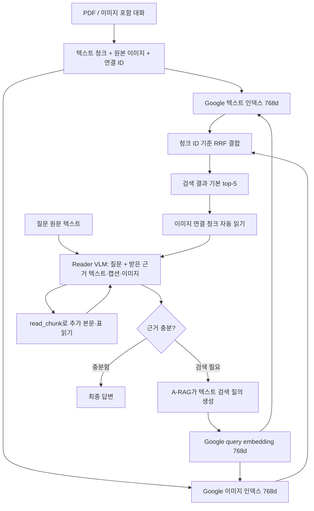

# Google 멀티모달 임베더를 A-RAG에 적용하는 구현 지시서

이 문서는 **Qwen 텍스트 검색을 Google EmbeddingGemma 2의 텍스트·이미지 검색으로 바꾸고, 검색한 근거 이미지를 Reader VLM에 실제로 전달하는 구현 명세**다. 다른 AI가 파일·데이터 구조·실행 순서·검증 조건을 그대로 따라 구현할 수 있도록 작성했다.

대상 모델은 `google/embeddinggemma-2`, 코드의 조건 이름은 `G1`이다. Reader VLM은 별도 모델 `google/gemma-4-E4B-it`이다. 임베더는 검색 벡터를 만들고, Reader는 찾은 근거의 텍스트와 이미지를 읽어 답한다.

2026-10-13 기준. 본 저장소에는 Google-only 검색과 **검색 연결 이미지 자동 전달** 구현이 있다. [결과 보고서](../lab/reports/INTERIM_REPORT.md)의 기존 수치는 자동 전달 수정 **이전**의 `agent-read` 정책으로 측정했다. 수정된 `search-linked` 정책은 소프트웨어 테스트를 통과했지만 벤치마크 성능은 아직 측정하지 않았다. 사용자가 이후 각 벤치마크 100문항의 재측정을 명시적으로 승인했다. 이번 승인 범위에서는 수정 방식으로 조건별 문항당 한 번씩 다시 측정하며, 이전 수치를 수정된 구조의 성능으로 표시하지 않는다.

## 1. 구현할 최종 동작

### 입력별 사용 규칙

아래 표가 본 실험의 입력 조건이다. “질문 이미지”와 “검색한 근거 이미지”를 구분한다.

| 입력 | 검색·임베딩 단계 | Reader VLM 단계 |
|---|---|---|
| 사용자의 질문 원문 텍스트 | A-RAG가 만든 검색어 텍스트의 Google query embedding | 입력 |
| 원래 질문에 첨부된 이미지 | 이번 text-query 비교에서는 제외 | 제외 |
| 원래 질문 이미지의 설명 캡션 | 제외 | 제외 |
| 검색 대상 문서·대화의 텍스트·이미지 캡션·주석 | Google text embedding | 읽은 청크의 원문 입력 |
| 검색 대상 문서·대화의 실제 이미지 | Google image embedding | **검색 결과에 연결된 이미지를 자동 읽기 후 입력** |

질문 이미지·캡션을 제외했다는 말은 Reader가 이미지를 전혀 받지 않는다는 뜻이 아니다. Reader에는 **검색으로 찾은 근거 이미지**가 들어간다. 이 규칙은 Qwen, Google text-only, Google multimodal 세 조건 모두에 동일하게 적용한다.

### 전체 흐름



자동 읽기는 도구 실행 내부의 처리다. 별도의 모델 호출이나 A-RAG iteration을 추가하지 않는다. 이미지가 준비되면 **다음 Reader 호출 전에** 실제 이미지 메시지를 추가한다. 남은 이미지 예산을 넘는 항목은 명시적으로 기록한다.

## 2. 필수 변경 사항과 파일

기존 Qwen 기반 프로젝트에 이 구조를 옮길 때 다음 변경을 모두 구현한다. 본 저장소에서는 아래 파일이 기준 구현이다.

| 변경 | 기준 파일 | 완료 조건 |
|---|---|---|
| 실제 이미지 추출·청크 연결 | [ir.py](../src/lsdrag/ir.py), [memgallery.py](../src/lsdrag/memgallery.py) | 모든 검색 이미지에 `figure_id`, `chunk_id`, 실제 이미지 파일이 있음 |
| Google 임베딩 어댑터 | [embeddings.py](../src/lsdrag/embeddings.py) | 텍스트·이미지·질문 모두 같은 고정 모델의 768차원 벡터 |
| 텍스트·이미지 인덱스 | [index.py](../src/lsdrag/index.py), [build_index.py](../scripts/build_index.py) | `gemma_text`, `gemma_image` 두 인덱스 완성 |
| 검색 결과 결합 | [retrieval.py](../src/lsdrag/retrieval.py) | `G1`은 Google 인덱스만 조회하고 청크 ID로 RRF 결합 |
| 검색된 이미지 자동 읽기 | [context.py](../src/lsdrag/context.py) | `read_search_images()`가 반환된 이미지 연결 청크를 읽고 전송 큐에 넣음 |
| Reader에 실제 이미지 전송 | [agent.py](../src/lsdrag/agent.py) | tool 결과 뒤 user 이미지 메시지, 성공 응답 후 전달 기록 |
| 공통 프롬프트·실행 설정 | [search_linked.txt](../prompts/search_linked.txt), [run_experiment.py](../scripts/run_experiment.py) | 세 조건 모두 같은 자동 전달 정책·프롬프트·iteration |
| 검증·실행 식별 | [tests](../tests/), `run_manifest.json` | 입력·인덱스·모델 설정·정책·코드 revision 기록 |

임베더 이름만 바꾸는 것으로는 충분하지 않다. **실제 이미지의 벡터 인덱스, 이미지→청크 연결, 검색 후 실제 이미지 전송**까지 구현해야 한다.

## 3. 모델과 실행 환경 고정

### 모델 설정

| 역할 | 모델 / revision | 출력·용도 |
|---|---|---|
| Google 임베더 | `google/embeddinggemma-2` / `914f7f89142e33e77833254d9c9b90c3cef7303b` | full 768d, 텍스트+이미지 |
| 비교용 Qwen 임베더 | `Qwen/Qwen3-Embedding-4B` / `5cf2132abc99cad020ac570b19d031efec650f2b` | 2560d, 텍스트 |
| Reader VLM | `google/gemma-4-E4B-it` / `ee0ef6023621cff504d758262d4e04895a5af4a2` | 이미지 포함 근거 읽기·답변 |
| PDF 파서 | `opendatalab/MinerU2.5-Pro-2604-1.2B` / `d3f5e08d073c21466bbabe21c71bb1e9c2e595da` | PDF의 원문·표·이미지 추출 |

Google 어댑터는 `config_kwargs={"audio_config": None}`으로 사용하지 않는 오디오 인코더를 제외하고 비전 인코더는 유지한다. 현재 `C1`도 같은 어댑터를 로드하지만 텍스트 인덱스만 사용한다. C1을 텍스트·비전 동시 검색으로 바꾸면 통제 조건이 사라진다.

모델 출력은 768차원 그대로 사용한다. 차원 축소·양자화·새 프롬프트의 효과는 본 비교에서 측정하지 않았다.

### 확인된 환경

실제 임베딩 환경: PyTorch `2.11.0+cu130`, Transformers `5.19.0`, sentence-transformers `6.1.0`, NumPy `2.5.4`, Pillow `12.3.0`. Reader 환경은 vLLM `0.20.0`, Transformers `5.6.2`다. 두 Transformers 버전이 다르므로 가상환경을 분리한다.

- [embedding-requirements.txt](../configs/embedding-requirements.txt)
- [runtime-requirements.txt](../configs/runtime-requirements.txt)
- [parser-requirements.txt](../configs/parser-requirements.txt)

GPU에서는 `bfloat16`, CPU에서는 `float32`를 사용한다. `float16`으로 바꾸지 않는다. 실제 저장 벡터는 float32로 변환·검증·정규화한다. GPU가 bfloat16을 지원하는지 먼저 확인한다.

새 머신에서는 하드웨어에 맞는 PyTorch를 먼저 설치·검증한 뒤 임베딩 환경을 만든다. 다음 예시는 이미 정상 동작하는 PyTorch가 기본 환경에 설치된 경우다. 명령은 문서 예시이며 이번 문서 작업에서 모델 서버나 실험을 시작하지 않는다.

```bash
# 저장소 루트에서 실행. 시스템 HOME 대신 작업 전용 변수 사용.
export LSDRAG_WORK_ROOT=/data/lsdrag-work
task_root="$LSDRAG_WORK_ROOT"
mkdir -p "$task_root"
python -m venv --system-site-packages "$task_root/embedding-env"

# 확인된 기본 PyTorch가 의존성 설치 중 교체되지 않도록 고정.
task_torch_version=$(python -c 'import torch; print(torch.__version__)')
echo "torch==$task_torch_version" > "$task_root/torch-constraints.txt"
"$task_root/embedding-env/bin/python" -m pip install \
  -c "$task_root/torch-constraints.txt" -r configs/embedding-requirements.txt
"$task_root/embedding-env/bin/python" -m pip install \
  -c "$task_root/torch-constraints.txt" -e .
```

Resolver가 의존성 충돌을 보고하면 원인을 해결하고 설치 버전을 기록한다. 임베딩 환경에 Reader의 Transformers 버전을 덮어쓰거나, 실험 중 자동으로 최신 모델 revision을 받지 않는다.

### 임베더 다운로드

```python
import os
from pathlib import Path
from huggingface_hub import snapshot_download

root = Path(os.environ["LSDRAG_WORK_ROOT"])
snapshot_download(
    repo_id="google/embeddinggemma-2",
    revision="914f7f89142e33e77833254d9c9b90c3cef7303b",
    cache_dir=str(root / "hf"),
    ignore_patterns=["*.onnx", "onnx/*", "*.tflite", "*.h5", "*.msgpack", "*.gguf", "*.bin"],
)
```

코드가 찾는 경로는 `<cache>/models--google--embeddinggemma-2/snapshots/<revision>/`이다. 모델 revision을 변경하면 관련 인덱스도 새 식별자로 관리해야 한다.

## 4. 데이터 구조: 실제 이미지 연결을 먼저 만든다

PDF는 MinerU가 저장한 실제 이미지 crop을 사용한다. 캡션을 새로 만들어 추가하지 않는다. 캡션이 없다는 이유로 이미지를 버리지 않는다.

### PDF 파싱이 이미 끝난 경우의 IR 생성

`parsed/<document_id>/structured_content.json`, `_SUCCESS.json`, `images/`가 있으면 파서를 다시 실행할 필요가 없다. `corpus_sources.jsonl`은 `{document_id, title, url}` 행으로 구성한다.

```bash
"$task_root/embedding-env/bin/python" scripts/build_ir.py \
  --parsed-root "$task_root/data/parsed" \
  --corpus-manifest "$task_root/data/corpus_sources.jsonl" \
  --output "$task_root/data/corpus" --max-words 300
```

이 명령이 `chunks.jsonl`, `figures.jsonl`, `documents.jsonl`, `manifest.json`을 만든다. PDF부터 시작하면 고정 파서 환경·서버를 준비한 뒤 `parse_pdfs.py --input ... --output ... --tier standard`를 먼저 실행한다. 메모리 대화 자료는 [convert_scenario()](../src/lsdrag/memgallery.py)의 원래 턴·이미지·제공 캡션 변환을 사용한다. 원래 질문·정답은 코퍼스와 별도 manifest로 관리한다.

### `chunks.jsonl`

청크에는 최소한 다음 필드가 있어야 한다. 예시는 스키마이며 ID·경로는 실제 데이터로 채운다.

```json
{
  "chunk_id": "doc1:p0:b3:s0",
  "document_id": "doc1",
  "document_ids": ["doc1"],
  "title": "Document title",
  "page_index": 0,
  "kind": "image_caption",
  "text": "Document title\nOriginal caption or nearby text",
  "figure_ids": ["doc1:p0:f3"],
  "previous_chunk_id": null,
  "next_chunk_id": null
}
```

텍스트 전용 청크는 `figure_ids=[]`다. `kind`만 보고 판단하지 말고 실제 `figure_ids` 연결을 사용한다. 한 대화 청크에 여러 사진이 있으면 해당 사진 ID를 모두 연결한다.

### `figures.jsonl`

```json
{
  "figure_id": "doc1:p0:f3",
  "chunk_id": "doc1:p0:b3:s0",
  "document_id": "doc1",
  "document_ids": ["doc1"],
  "title": "Document title",
  "page_index": 0,
  "image_path": "/data/lsdrag-work/assets/actual-image.jpg",
  "image_sha256": "SHA256_OF_ACTUAL_FILE_BYTES",
  "caption": "",
  "footnotes": "",
  "has_caption": false,
  "has_description": false
}
```

`image_sha256`는 실제 파일 바이트의 SHA256으로 계산한다. `figure.chunk_id`와 `chunk.figure_ids`는 양방향으로 일치해야 한다. 같은 Wikipedia URL의 여러 문서 ID는 하나의 물리 문서로 묶고 `document_ids`에 원래 별칭들을 보존한다.

실행 시 `image_path`는 실제 파일로 해석되어야 한다. 다른 머신으로 이동할 때 경로를 재해석하되 이미지 바이트·ID는 보존한다. 상대 경로를 그대로 현재 작업 디렉터리에 의존해 열지 않는다.

### 캡션 처리

PDF의 검색용 이미지 청크 텍스트는 다음 순서로 만든다.

1. 원문 캡션과 이미지 주석이 있으면 사용한다.
2. 둘 다 없으면 `[No caption. Nearby document text follows.]`와 주변 텍스트를 붙인다.
3. 주변 텍스트를 시각적 캡션이라고 부르지 않는다. `has_caption=false`를 유지한다.
4. 이미지 인덱스는 이 설명 텍스트가 아니라 **실제 이미지 픽셀**로 만든다.

Mem-Gallery는 데이터셋이 제공한 대화 이미지 캡션을 보존한다. 질문 이미지에 붙은 설명과 검색 대상 대화 이미지의 캡션은 서로 다른 필드다. 질문 이미지 캡션을 검색 질문에 몰래 붙이지 않는다.

## 5. Google 임베딩: 정확한 입력 형식

### 역할별 입력

| 역할 | 모델 입력 |
|---|---|
| 검색 질문 | `task: search result \| query: {query}` |
| 문서 문장·캡션 | `title: {title 또는 none} \| text: {content}` |
| 실제 이미지 | RGB `PIL.Image`; 텍스트 prefix 없음 |

본 실험은 search-result prefix를 사용한다. question-answering prefix로 바꾸면 새로운 설정이므로 별도 검증해야 한다.

이미지는 **PIL 객체**로 인코딩한다. 이미지 파일 경로 문자열을 `encode()`에 넣으면 이미지 픽셀 임베딩을 구현한 것이 아니다.

### 본 저장소 어댑터 사용 예시

```python
from pathlib import Path
from PIL import Image
from lsdrag.embeddings import Embedder

embedder = Embedder("gemma", cache_dir="/data/lsdrag-work/hf", device="cuda", batch_size=16)
query = embedder.encode(["a poster showing a penguin"], role="query")
text = embedder.encode(["Theatrical release poster"], role="document", titles=["Happy Feet"])

with Image.open(Path("/data/lsdrag-work/assets/actual-image.jpg")) as source:
    rgb = source.convert("RGB")
    try:
        visual = embedder.encode([rgb], role="image")
    finally:
        rgb.close()

assert query.shape == text.shape == visual.shape == (1, 768)
```

`Embedder.encode()` 내부의 필수 규칙:

```python
# 직접 prefix를 구성했으므로 라이브러리 prompt를 다시 붙이지 않는다.
values = model.encode(
    formatted_inputs,
    batch_size=16,
    prompt="",
    normalize_embeddings=False,
    show_progress_bar=False,
)
# 이후 float32 변환, 유한성 검사, L2 정규화, (N, 768) 검사.
```

정규화는 `v / ||v||₂`다. NaN·Inf·0-norm을 발견하면 인덱스 완성을 중단한다. 정규화한 벡터끼리 내적하면 cosine similarity가 된다.

한 번 만든 Google query 벡터를 텍스트 인덱스와 이미지 인덱스에 함께 사용할 수 있다. 현재 구현은 `(channel, query)` 키로 캐시한다. 검색 질의는 원 질문에서 A-RAG가 만든 텍스트이며 두 채널이 같은 모델·차원을 쓰기 때문이다.

## 6. 인덱스 두 개를 만들고 Qwen 벡터와 분리한다

### 텍스트 인덱스 `gemma_text`

- 원래 A-RAG 방식처럼 청크 텍스트를 문장 단위로 나눈다.
- 각 문장에 `chunk_id`, `sentence_id`, `text`, `title`을 보존한다.
- Google document 형식으로 인코딩한다.
- float32, L2 정규화, 768차원으로 저장한다.

### 이미지 인덱스 `gemma_image`

- 실제 그림 한 장당 한 벡터를 만든다.
- 각 행에 `figure_id`뿐 아니라 부모 `chunk_id`를 반드시 저장한다.
- 같은 청크의 사진 여러 장도 각각 인코딩한다.
- 캡션 없는 이미지도 포함한다.

Qwen의 2560차원 벡터를 Google query의 768차원과 비교하지 않는다. Qwen 인덱스는 B0용으로 남기고 Google 텍스트 인덱스를 별도로 만든다. 이미 같은 Google revision·입력·정규화로 만든 유효 인덱스가 있으면 그대로 재사용한다.

```bash
# 이미 준비된 corpus 디렉터리를 사용한다.
# 위에서 정의한 task_root가 유지되는 셸, 저장소 루트에서 실행.
"$task_root/embedding-env/bin/python" scripts/build_index.py \
  --corpus "$task_root/data/corpus" \
  --output "$task_root/indexes/gemma_text" \
  --channel gemma --modality text \
  --cache-dir "$task_root/hf" --batch-size 16 --device cuda

"$task_root/embedding-env/bin/python" scripts/build_index.py \
  --corpus "$task_root/data/corpus" \
  --output "$task_root/indexes/gemma_image" \
  --channel gemma --modality image \
  --cache-dir "$task_root/hf" --batch-size 16 --device cuda
```

각 디렉터리에 `vectors.npy`, `rows.jsonl`, `manifest.json`을 만든다. Manifest에는 모델·revision·modality·dimension·dtype·정규화·query instruction·원본 파일 해시·행 파일 해시·벡터 파일 해시를 기록한다. 부분 파일은 완성 후 원자적으로 교체하고, 최종 manifest가 없는 인덱스를 완성된 것으로 취급하지 않는다.

### 새 문서만 추가하는 경우

기존에 완성한 Google 인덱스가 유효하면 새 문서 부분만 임베딩한다. [compose_index.py](../scripts/compose_index.py)로 기존·추가 shard를 참조하는 composite 인덱스를 만들 수 있다.

두 shard의 모델·revision·modality·dimension·dtype·정규화·query instruction이 같아야 한다. 합친 source 행은 shard source 행을 **같은 순서로 연결한 것과 정확히 일치**해야 하며 청크·그림 ID가 중복되면 실패시킨다. 현재 composite 검색은 벡터를 메모리에 concatenate하므로 디스크 복사는 줄지만 검색 시 메모리까지 줄이는 구조는 아니다.

## 7. 검색 결합: 공통 청크 ID로 RRF

G1의 `semantic_search(query, top_k=5)`는 다음 순서를 지킨다.

1. Google query 벡터를 구한다.
2. Google 텍스트 인덱스에서 문장 상위 180개를 보고 청크별 최고 점수 문장으로 중복 제거하여 최대 60개 청크를 얻는다.
3. Google 이미지 인덱스에서 이미지 점수 순으로 부모 `chunk_id`를 중복 제거하여 최대 60개 청크를 얻는다.
4. 두 청크 순위를 RRF(k=60)로 결합한다.
5. 기본 top-5를 반환한다. API가 받은 `top_k`는 1~20 범위로 제한한다.
6. 이미지 연결 청크를 자동 읽기한다. 이 단계는 다음 절에서 설명한다.

이미지 순위를 `figure_id`로 그대로 텍스트 `chunk_id` 순위와 합치면 같은 자료가 서로 다른 후보로 갈라진다. **부모 청크 ID로 먼저 맞춘다.**

```python
from collections import defaultdict

def rrf(rankings, k=60):
    scores = defaultdict(float)
    for ranking in rankings:
        seen = set()
        for rank, chunk_id in enumerate(ranking, start=1):
            if chunk_id not in seen:
                scores[chunk_id] += 1.0 / (k + rank)
                seen.add(chunk_id)
    return sorted(scores, key=lambda cid: (-scores[cid], cid))

assert rrf([["a", "b"], ["b"]])[0] == "b"
```

벡터의 원시 similarity 점수를 더하거나 평균하지 않는다. 다른 채널의 점수 분포가 달라도 순위만으로 결합하도록 한다. 동점은 청크 ID 순서로 결정해 재현성을 유지한다.

Mem-Gallery에서 검색 범위는 공개 입력의 `scenario`다. 텍스트·이미지 양쪽에 같은 allowed 청크 집합을 적용하고 **범위를 필터링한 뒤 top 후보를 선정**한다. 정답 `clue`, 정답 이미지 ID, 정답 문서 ID로 범위를 좁히면 안 된다.

G1은 `gemma_text`, `gemma_image`, `embedders={"gemma": ...}`만 로드한다. `qwen_text`를 남겨 보완하거나 Qwen ranking을 융합하면 현재의 Google-only 비교가 아니다.

## 8. 검색된 이미지는 에이전트 선택을 기다리지 않고 읽는다

### 수정 전 정책: `agent-read`

검색 결과는 짧은 텍스트 목록이다. 에이전트가 별도로 `read_chunk`를 선택했을 때만 연결된 이미지를 전송한다. 보고서의 기존 벤치마크 수치는 이 정책으로 측정했다.

정답 이미지가 검색됐다는 사실만으로 실제 입력을 보장하지 못했다. 기존 M3DocVQA 개발 G1은 정답 이미지 후보가 나온 27문항 중 9문항에서만 이미지를 전달했다. 나머지 18문항은 해당 이미지 청크를 읽지 않았다.

### 수정한 정책: `search-linked`

다음 자동 처리를 **Qwen·Google text-only·Google multimodal 공통으로** 수행한다.

```python
result = retrieval.keyword_search(...)  # 또는 semantic_search(...)
result = context.read_search_images(result, source_tool="keyword_search")
# result는 계속 검색 결과 list다.
# 이미지 연결 항목에는 auto_read: {full text, figures, status, ...}가 추가된다.
# 실제 이미지는 context.pending_images에 들어간다.
```

`EvidenceContext.read_search_images()`의 구현 계약:

1. 검색이 실제 반환한 결과만 대상으로 한다. top-60 내부 후보나 정답 파일을 따로 훑지 않는다.
2. 결과의 `chunk_id`로 실제 청크를 찾아 `figure_ids`가 있는 항목을 선택한다.
3. 반환 순서를 유지하고 중복 청크를 제거한다.
4. `read()`가 한 번에 1~8개 청크를 받으므로 필요하면 8개씩 나누어 읽는다.
5. 이미지 파일 SHA256을 기준으로 전송 중복을 제거한다.
6. 남은 공통 이미지 예산까지 전송 큐에 넣는다. 초과 이미지는 `image_budget_exhausted`로 표시한다.
7. 검색 결과는 list로 유지하고 원래 순서를 보존한다. 이미지 연결 항목에만 `auto_read` 원문·그림 상태를 추가한다.
8. 자동 읽기를 `evidence_events`에 기록한다. 모델이 별도 `read_chunk`를 호출한 것처럼 기록하지 않는다.

텍스트 전용 청크는 자동으로 모두 읽지 않는다. 기존 `read_chunk` 도구를 통해 추가 본문·표·인접 문맥을 읽을 수 있다. 이미지 연결 청크의 텍스트·캡션은 자동 읽기 과정에서 함께 입력한다.

이 수정은 후보 이미지가 실제 이미지 예산 안에서 입력되는 연결을 보장한다. **정답률 개선까지 보장하는 것은 아니다.** 예산 초과·관련 없는 상위 후보·질문 정보 부족·Reader 추론 오류는 따로 평가해야 한다.

## 9. Reader VLM 메시지와 전달 기록

이미지를 검색 결과 JSON 안에 base64 문자열로 넣고 끝내면 안 된다. 실제 멀티모달 user content block을 사용한다.

메시지 순서는 다음과 같다.

```text
assistant: semantic_search tool call
    ↓
tool: 검색 결과 + 이미지 연결 항목의 auto_read 원문/캡션/상태
    ↓
user: 원래 질문 안내 + Figure ID + image_url 실제 이미지
    ↓
assistant / Reader VLM: 이미지와 원문을 읽고 답하거나 추가 도구 선택
```

API 입력 형태:

```json
{
  "role": "user",
  "content": [
    {"type": "text", "text": "Requested document figures follow. Continue answering the original question: ..."},
    {"type": "text", "text": "Figure IDs: doc1:p0:f3"},
    {"type": "image_url", "image_url": {"url": "data:image/jpeg;base64,ACTUAL_IMAGE_BYTES"}}
  ]
}
```

기준 구현은 `image_message()`가 파일 바이트를 읽고 저장된 해시와 비교해 data URL을 만든다. 실제 요청에서는 base64를 보내되 결과 JSON에는 base64를 저장하지 않는다. 로컬 이미지 ID·파일 해시·호출 기록으로 추적한다.

### 읽음·큐에 넣음·전달 성공을 구분

- `read_chunk_ids`: 원문을 읽은 청크. 자동 읽기도 포함한다.
- `opened_figure_ids`: 이미지 연결을 처리한 ID. 예산 초과 그림도 포함될 수 있다.
- `pending_figure_ids`: 다음 Reader 호출에 보낼 준비가 됐지만 성공 확인이 안 된 ID.
- `delivered_figure_ids`: 이미지를 포함한 Reader 요청에 **성공 응답을 받은 뒤** 기록한 ID.
- `unique_delivered_images`: 파일 SHA256 기준으로 중복 제거한 전달 수.

대화는 stateless API에 전체 history를 보내므로 이전 이미지 block이 후속 요청의 history에 다시 포함될 수 있다. 중복 제거는 같은 그림의 새 block을 반복 추가하지 않는다는 의미이며, 지표는 고유 이미지 기준이다.

Reader 요청이 실패했는데 이미 전달됐다고 기록하지 않는다. 같은 파일 해시를 가진 여러 figure ID는 하나의 실제 이미지 입력으로 보내고 해당 별칭 ID들은 모두 연결해 기록한다.

## 10. A-RAG 설정과 세 조건의 공정성

| 항목 | 공통 값 |
|---|---|
| `max_loops` | 8 A-RAG agent iterations |
| `image_delivery_policy` | 수정한 실험에서는 세 조건 모두 `search-linked` |
| `question_image_policy` | `text-only`: 질문 이미지·그 캡션 제외 |
| Reader VLM | Gemma 4 E4B-it |
| temperature / seed | 0 / 20261013 |
| 최대 출력 / context | 1,024 / 32,768 tokens |
| 고유 근거 이미지 예산 | 풀이당 최대 8개 |
| 도구 | `keyword_search`, `semantic_search`, `read_chunk` |
| 프롬프트 | 수정한 실험에서는 같은 `prompts/search_linked.txt` |

에이전트 루프는 최대 8회이고, 한도에 도달하면 별도의 최종 답변 호출을 할 수 있다. 8번 도구 처리 뒤 최종 Reader 호출이 9번째가 되어도 정상이다. Reader 호출 수 자체에 별도 8회 제한을 걸지 않는다.

자동 읽기는 iteration을 소비하거나 별도의 Reader를 호출하지 않는다. 다음 정상 Reader 호출, 또는 한도 도달 후 최종 호출 전에 준비된 이미지를 추가한다.

`configs/original_arag.yaml`은 별도의 upstream 원형 재현용 설정이다. 현재 `scripts/run_experiment.py` 실행은 `AgentConfig`와 CLI 설정을 사용한다. 원형 YAML의 15회를 고치는 것만으로 현재 실행의 max iteration이 바뀌지 않는다.

### 현재 코드의 기본값

- `AgentConfig.image_delivery_policy`와 `run_experiment.py` 기본값: `search-linked`.
- `agent-read`를 명시하면 수정 전 정책을 선택한다.
- `run_three_arm_comparison.py`의 development/additional50은 역사적 `agent-read` 설정이다. 새 `--evaluation-set search-linked100`은 사용자 승인된 100문항 재측정으로, 세 조건 모두 `search-linked`를 사용하며 새 output에 기록한다.
- 기존 run manifest에 정책·코드 revision이 다르면 resume를 거부한다. 기존 결과 파일을 새 설정의 결과로 덮어쓰지 않는다.

## 11. 실행 명령: 새 문항만, 새 output만

다음은 사용할 데이터·환경을 준비한 후의 실행 예시다. `<work_root>/data/new_questions/questions.jsonl`은 **이전에 풀지 않은 고유 문항**으로 만든다. 일반적인 새 평가에서는 기존 문항을 반복하지 않는다. 아래 별도 승인된 search-linked100 재측정은 예외다.

### 질문 입력 schema

M3DocVQA 계열:

```json
{"qid": "NEW_UNIQUE_ID", "question": "Original question text"}
```

Mem-Gallery 계열:

```json
{
  "qid": "NEW_UNIQUE_ID",
  "question": "Original question text",
  "scenario": "Public scenario identifier",
  "task_type": "VR",
  "question_image_paths": []
}
```

실험 입력에는 정답·`clue`·정답 이미지 ID·질문 이미지 설명인 `image_caption`을 넣지 않는다. 원래 질문 이미지·설명은 별도의 gold/원자료에 보존하되 실행에는 공급하지 않는다. 현재 runner는 허용된 입력 key 집합을 정확히 검사한다.

### Reader 준비

Gemma 4 Reader를 쓸 때 고정 revision을 별도 runtime 환경으로 다운로드하고, [start_server.sh](../scripts/start_server.sh)를 사용한다. `LSDRAG_WORK_ROOT`를 설정하면 script의 cache/runtime 경로도 같은 root를 사용한다. `gemma-reader`, port 8102, tool-call parser `gemma4`, 이미지 제한 8개 설정이 필요하다.

이미 같은 기능의 VLM 서버를 사용 중이면 해당 OpenAI-compatible `/v1` endpoint를 `--base-url`로 지정한다. 실제 이미지 user 메시지와 tool call을 함께 처리하는지 먼저 synthetic smoke test로 확인한다.

### G1 실행

```bash
# 추적 실행 전 코드와 설정을 commit하여 working tree를 clean 상태로 둔다.
# output은 아직 결과가 없는 새 디렉터리다.
"$task_root/embedding-env/bin/python" scripts/run_experiment.py \
  --arm G1 --benchmark m3docvqa \
  --corpus "$task_root/data/corpus" \
  --indexes "$task_root/indexes" \
  --questions "$task_root/data/new_questions/questions.jsonl" \
  --output "$task_root/results/new_search_linked/G1" \
  --cache-dir "$task_root/hf" \
  --base-url http://127.0.0.1:8102/v1 \
  --max-loops 8 \
  --question-image-policy text-only \
  --image-delivery-policy search-linked
```

공정 비교는 같은 인자에서 `--arm B0`와 `--arm C1`, 각각 다른 output 디렉터리로 실행한다. B0용 `qwen_text`도 준비한다. Mem-Gallery이면 `--benchmark memgallery`, 해당 코퍼스·질문 manifest를 사용한다.

이 문서의 명령은 자동 설치 스크립트가 아니다. 사용자 승인 없이 완료 문항을 반복하지 않는다. 이번 승인된 재측정은 아래 명령으로 실행한다.

### 이번 승인된 100문항 재측정

- M3DocVQA: 고정된 기존 100문항, 288문서 코퍼스, 새 전달 정책으로 각 조건 한 번씩.
- Mem-Gallery: 기존 60 + 층화 선정 40, 총 100문항(VS 50 + VR 50).
- 출력: `results/three_arm_search_linked100`.
- 선택 manifest: [search_linked100_selection.json](../lab/registry/search_linked100_selection.json).

```bash
python scripts/run_three_arm_comparison.py --evaluation-set search-linked100
```

## 12. 검증 기준: 코드만 돌아가는 것과 실제 전송을 구분

### 모델·인덱스 smoke

새 환경에서 한 번 확인한다. 벤치마크 문제를 재풀이하지 않고 synthetic 자료를 쓴다.

1. 텍스트 query, 문서 텍스트, 실제 PIL 이미지 각각 `(N, 768)`.
2. 벡터가 유한하고 L2 norm이 약 1.
3. text/image index 모델 revision·차원·정규화 일치.
4. 이미지 인덱스의 행이 실제 이미지 수와 일치하고 모든 부모 청크가 존재.
5. 텍스트 query로 실제 이미지 벡터 인덱스를 검색할 수 있음.
6. 캡션이 없는 이미지도 index에 있고 검색 후보가 될 수 있음.
7. 텍스트·이미지 양쪽에 같은 공개 검색 scope가 적용됨.

### 반드시 통과해야 하는 전달 테스트

합성 이미지와 FakeReader를 사용한다. 벤치마크 문제나 실제 GPU 모델 호출 없이 확인할 수 있다.

- Reader가 검색만 호출하고 `read_chunk`를 호출하지 않아도, 이미지 연결 결과의 실제 그림이 다음 Reader 입력에 포함됨.
- 이 동작이 B0·C1·G1 모두에서 같음.
- `keyword_search`와 `semantic_search` 양쪽에 적용됨.
- 첫 검색이 마지막 허용 iteration이면, 별도 최종 답변 호출에도 그림이 들어감.
- 검색 결과 순서가 바뀌지 않고 후보 recall을 계산할 수 있는 list 형태가 유지됨.
- 같은 그림의 새 image block은 중복 추가되지 않고, 이미지 예산 초과는 명시적으로 기록됨.
- 실패한 Reader 호출을 성공 전달로 집계하지 않음.
- `agent-read`를 명시하면 자동 읽기가 발생하지 않음.

기준 테스트:

```bash
python -m pytest -q tests/test_retrieval_ir.py tests/test_context.py tests/test_agent.py
python -m pytest -q
```

핵심 테스트는 `test_search_image_reaches_final_reader_without_a_read_tool`과 `test_auto_read_keeps_ranks_and_reports_dedup_and_budget`다. 2026-10-13 전체 테스트는 42개가 통과했다. 자동 전송의 기능 확인과 실제 벤치마크 정답률 검증은 다르다.

## 13. 측정·로그 계약

문항당 각 조건 한 번만 푼다. 오답을 다시 풀어 더 좋은 답을 선택하지 않는다. 인프라 실패는 실패 기록을 보존하고 원인을 조사한다.

`run_manifest.json`에 다음을 기록한다.

- arm, benchmark, 원 질문 파일 SHA256, 고유 question IDs.
- corpus manifest SHA256, 각 index manifest SHA256.
- prompt SHA256, code revision.
- `max_loops`, Reader 모델·endpoint·seed·token/context/image 설정.
- `question_image_policy`, `config.image_delivery_policy`.

문항 결과에는 `trajectory`, `reader_calls`, `evidence_events`, `read_chunk_ids`, `opened_figure_ids`, `pending_figure_ids`, `delivered_figure_ids`, `reader_call_count`, `loops`, `errors`를 남긴다. 이미지 전달 누락의 원인을 다음처럼 구분한다.

| 상태 | 해석 |
|---|---|
| 검색 결과에 정답 근거 없음 | 검색 단계 문제 |
| 반환 이미지 청크인데 자동 읽기 event 없음 | 연결·정책 구현 문제 |
| `image_budget_exhausted` | 이미지 예산 초과 |
| pending에 있는데 delivered에 없음 | Reader 호출 실패 또는 전송 완료 이전 종료 |
| delivered에 있는데 답변 오답 | 근거 관련성·추론·답변 형식 문제 |

주 결과 표는 EM·F1·이미지 전달 recall을 사용한다. 전달 recall은 한 번의 풀이에서 실제 Reader가 받은 정답 이미지 비율의 문항별 평균이다. `recall@K`로 부르지 않는다. 정답·이미지 대응 정보는 측정에서만 사용하며 검색·자동 전달에는 사용하지 않는다.

## 14. Mem-Gallery에서 효과가 작을 수 있는 이유

추가 50문항에서 전달 recall은 Qwen 52.1%, Google multimodal 52.2%였다. 문항별로 44개는 같고, 4개는 개선됐으며, 2개는 낮아져 평균 효과가 상쇄됐다. VS 25문항은 두 조건 모두 평균 64%였다. 이미지 예산을 소진한 문항은 없었다.

검색 대상 이미지 973개에 모두 데이터셋 캡션이 있어 Qwen도 텍스트 검색으로 상당 부분 찾을 수 있다. 따라서 이미지 채널 추가만으로 항상 개선되는 것은 아니다. 일부 사례에서 도움이 됐다는 사실과 전체 평균 개선은 구분한다. 이 수치는 자동 전달 수정 이전 정책의 결과다.

새 `search-linked` 방식은 전달 경로의 누락을 줄이려는 구현 수정이며, Mem-Gallery의 성능 개선까지 이미 입증했다는 의미가 아니다.

## 15. 자주 발생하는 구현 오류

| 오류 | 수정 |
|---|---|
| Google 이름만 바꾸고 Qwen 벡터 재사용 | Google 768d 텍스트 인덱스 새로 생성·검증 |
| 캡션만 임베딩하고 멀티모달이라고 표기 | 실제 이미지 픽셀 인덱스 추가 |
| 파일 경로 문자열을 이미지 입력으로 전달 | `PIL.Image` RGB 객체로 인코딩 |
| 수동 prefix와 `prompt_name`을 동시에 사용 | 한 방식만 사용; 본 구현은 수동 prefix + `prompt=""` |
| 이미지에 query/document 텍스트 prefix 적용 | 이미지에는 prefix 없음 |
| 이미지 순위 figure ID와 텍스트 순위 chunk ID를 직접 결합 | 이미지 결과를 부모 chunk ID로 통일 |
| Google와 Qwen ranking을 G1에서 혼합 | G1은 Google 텍스트·이미지 두 채널만 |
| top-K에 이미지를 찾았지만 Reader에는 텍스트만 입력 | `search-linked` 자동 읽기와 실제 user image block 구현 |
| 모든 검색 내부 후보 60개를 자동 전송 | 실제 반환 결과만 처리하고 공통 이미지 예산 적용 |
| 이미지 큐에 넣은 즉시 전달 성공으로 집계 | Reader 성공 응답 뒤 `mark_images_accepted()` |
| 질문 이미지 캡션을 질문 text에 추가 | 이번 비교에서는 제외; 원자료에만 보존 |
| 정답 clue로 검색 범위 축소 | 공개 scenario/tenant 범위만 사용 |
| max iteration 8을 Reader 총 호출 8로 구현 | 8 agent loops + 필요시 별도 최종 호출 |
| automatic 방식으로 기존 결과를 재해석 | 이전 측정 정책 표기, 새 정책은 미측정 상태로 유지 |

## 16. 다른 AI에게 넘길 구현 지시문

> `google/embeddinggemma-2`의 고정 revision을 사용해 Qwen 기반 A-RAG에 Google-only 텍스트·이미지 검색을 구현하라. 텍스트와 실제 PIL 이미지의 full 768d float32 L2 벡터를 별도 인덱스에 저장하라. 검색 질문은 원문 텍스트만 사용하고 질문 첨부 이미지·그 캡션은 공급하지 말라. 문서·대화의 원래 캡션은 검색 텍스트로 보존하라. Google text/image top 후보를 공통 chunk ID로 RRF(k=60) 결합하고 기본 top-5를 반환하라. 반환된 이미지 연결 청크는 별도 agent read 선택을 기다리지 않고 자동 읽기하여 다음 Reader VLM 호출 전에 실제 이미지 block으로 전달하라. 같은 자동 전달 정책을 B0·C1·G1 모두에 적용하라. 고유 이미지 예산 8개·A-RAG max iteration 8·별도 최종 답변 호출을 유지하라. 골드 정답·clue·정답 이미지 ID를 검색이나 자동 전달에 사용하지 말라. 실제 전송 성공 뒤에만 delivered ID를 기록하라. 정책·입력·인덱스·프롬프트·코드 해시를 실행 manifest에 남겨라. 합성 테스트로 전달 경로를 먼저 확인하라. 명시적으로 승인된 재측정 범위 밖에서 이미 푼 문항을 반복하지 말고, 수정 전 수치를 수정 후 성능으로 표시하지 말라. 기준 코드는 본 문서의 파일 목록을 따르라.

## 17. 근거·참조

- [고정 revision의 EmbeddingGemma 2 모델 설명](https://huggingface.co/google/embeddinggemma-2/blob/914f7f89142e33e77833254d9c9b90c3cef7303b/README.md): 공통 768d 공간, 검색 prefix, 이미지 입력, dtype·encoder 설정.
- [본 저장소 실험 계획](EXPERIMENT_PLAN.md) · [결과 보고서](../lab/reports/INTERIM_REPORT.md) · [정성 사례 원자료](../lab/reports/qualitative_cases/README.md).
- [A-RAG 원본](https://github.com/Ayanami0730/arag) · [M3DocVQA](https://github.com/bloomberg/m3docrag) · [Mem-Gallery](https://github.com/YuanchenBei/Mem-Gallery).
