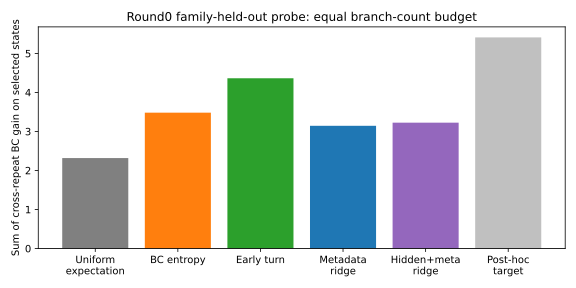

# 중요 상태 사전 예측 점검 — 2026-10-23

**판정: 사전 지정 gate 미통과. 현재 중요도 예측기로 실제 선택 수집을 확대하지 않는다.** 아직 새 rollout 절약이나 독립 정책 성능을 입증한 실험은 아니다.

## 주 검증: round0만 사용

고정 BC reference로 수집한67상태/24질문을 family 연결성분으로6fold 분리. Held-out 질문의 중요도 target은 fitting·정규화·선택에 사용하지 않는다. 단, frozen BC 자체는기존24질문teacher label을학습한모델이므로완전히새질문의end-to-end성능이라고부르지않는다. 이전분기audit로전체자료의집중도는이미관측했으므로이검증도완전한confirmatorytest가아니다.

각상태를고르면합법행동당2suffix를수집한다고가정. 6/8개의branch수에맞춰모든방법의실제선택비용을정확히같게맞췄다. Token·wallclock비용은아직동등하지않다. Random은같은정확예산을쓰는feasible subset의uniform기댓값이다.

| 방법 | 분기 예산 | 선택 상태 | Cross-repeat gain 합 | 같은 표본 평균 target gain 합 |
|---|---:|---:|---:|---:|
| uniform_exact_expectation | 114 | 18.00 | 2.3173 | 3.1109 |
| BC_entropy | 114 | 18.00 | 3.4811 | 4.5991 |
| early_turn | 114 | 18.00 | 4.3622 | 4.4744 |
| metadata_ridge | 114 | 18.00 | 3.1436 | 4.0539 |
| hidden_metadata_ridge | 114 | 18.00 | 3.2243 | 3.4197 |
| posthoc_mean_target | 114 | 18.00 | 5.4096 | 6.0904 |

Cross-repeat는한repeat로bestaction을고르고다른repeat로BC대비효용차를평가한값이다. Importance selector는held-out결과를사용하지않지만,최종metric계산에는사후분기결과가필요하다. Post-hoc row는배포가능방법이아니며cross-repeat상한도보장하지않는다.

Hidden+metadata 대uniform의합차이+0.9070,조건부familybootstrap95%CI[-0.3208,+2.3948],fold승수4/6. CI는고정OOFprediction의family불확실성일뿐재학습·수집seed변동을포함하지않는다.

## 더 넓은 진단

- Hidden+metadata와작은metadata만의차이는고차원표현이정말필요한지판별한다. 무조건복잡한head로진행하지않는다.
- Round1은전체trainoutcome을보고개선된reference로수집됐으므로주CV에넣지않았다.
- 동일공개prefix 41개중bestaction변화9개,평균actionQ변화0.0774. 이값에는reference변경과MC잡음이섞여있다.
- 선택상태중요도가학습loss/episode품질개선과같지않다. 실제학습효율의최종판정은같은예산으로모은데이터로policy를학습하고새episode로평가해야한다.

## 다음 행동

Gate 미통과면추가selector튜닝으로동일fold를계속소모하지않는다. 반복suffix로target신뢰도를확인하거나종료·Qcoverage문제를별도로진단한다. Gate 통과여도새질문/seed와token예산을고정한실제수집대조가필요하다. 기존결과100/20/40/60/60은튜닝에사용하지않는다.

[동결 protocol](JEV_DECISION_ACQUISITION_PROBE_20261023.md),[기계판독결과](../lab/reports/decision_acquisition_probe_20261023/result.json).
