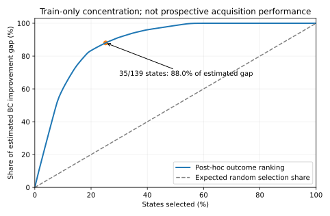

# 학습 분기 부산물 분석: 중요한 결정이 모여 있는가?

이 분석은 기존 train24의 두 round139상태/990분기만 읽는다. 평가 결과·정답은 읽지 않았고 새 모델 실행/정책 학습도 없다. 정책학습 성능·novelty 증명이 아니라 후속 연구 가설 점검이다.

## 이번 관측의 의미

- 139상태 중73개는 행동별 평균 F1이 달랐고,45개는 FINAL을 제외해도 F1범위가0.25 이상이었다. 종료만의 문제가 아닐 가능성을 살펴볼 근거다.
- 평균utility 기준BC대비개선여지의88.0%가결과순위상위35상태에모였다. 두repeat 모두같은대안이BC보다0.05넘게좋은상태는40개였다.
- Repeat끼리최고utility행동은84.9%일치했다. 한repeat로고르고다른repeat에서평가한평균gain은.1188로,같은두표본평균에서고른낙관적추정.1488보다낮았다. 두표본만으로안정성을확정하지않는다.
- BC entropy와추정개선여지의train상관은.186으로작았다. 기존확률의불확실성만보고중요한상태를찾을수있다고주장할근거는없다.

**현재발견은탐색예산배분가설의근거이지,탐색절감에성공한결과가아니다.** 다음단계는outcome을보기전에상태를고르는selector의질문별검증과동일예산uniform비교다.

## 정의와 집계

각 상태의 행동별 평균 utility를 `Q(a)=mean(F1−.03·remaining cost)`로 두고, `max Q−Q(BC 선택)`을 추정 개선 여지로 본다. 행동간 F1범위는 비용과 분리한다. 두 suffix의 한쪽으로 best action을 고른 뒤 다른쪽에서 BC대비 이득을 재계산하고 방향을 뒤집어 평균하여 선택 낙관성을 점검한다. 두 표본만으로 불확실성이 검증된 것은 아니다.

| 지표 | 결과 |
|---|---:|
| states | 139 |
| quality_range_gt0 | 73 |
| quality_range_ge025 | 65 |
| nonfinal_quality_range_ge025 | 45 |
| estimated_regret_gt005 | 55 |
| consistent_alternative_gain_gt005 | 40 |
| argmax_agreement | 0.8489 |
| epsilon_optimal_set_overlap | 0.8561 |
| estimated_regret_mean | 0.1488 |
| cross_repeat_gain_mean | 0.1188 |
| top_quarter_share_estimated_regret | 0.8802 |
| question_balanced_estimated_regret | 0.1507 |
| question_balanced_cross_repeat_gain | 0.1191 |

상위25% 집중도는 **결과를 본 뒤 순위를 정한 분석상 상한**이다. 온라인에서 이 상태들을 미리 고를 수 있다거나 그만큼 rollout을 줄일 수 있다는 뜻이 아니다. 초기BC entropy/turn과의 상관도 동일train상의 기술통계이며 일반화 예측력으로 해석하지 않는다.

## 다음에 판별해야 할 것

1. Repeat를 더 수집한 일부 train상태에서 행동 순위와 contrast가 유지되는지 확인한다. 큰 observed gap만 재실행하면 selection bias가 있으므로 작은 gap/무작위 상태도 포함한다.
2. 질문·family 단위 분할로 앞서 얻은 정보만 보는 acquisition score를 학습한다. 평가용 branch outcomes는 수집 선택 전에 숨긴다.
3. 같은 실제 rollout/token 예산의 uniform state 선택과 비교한다. 중요한 상태 발견률뿐 아니라 그 데이터로 학습한 policy의 독립 episode 품질–비용을 측정한다.
4. 독립 reference/수집seed에서도 효과가 남는지 검증한다. 현재139상태와 두샘플만으로 중요한상태의보편적희소성을주장하지않는다.

[원수치와state별추적](../lab/reports/decision_policy_20261023/train_branch_value_audit.json), [반사실학습수식](JEV_DECISION_POLICY_MATH_20261023.md).
