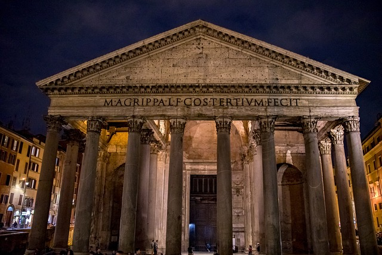

# Qwen 대신 Google 멀티모달 임베더를 쓰면 도움이 되는가?

**문서 이미지 검색에는 도움이 됐다. Mem-Gallery 정답률 개선은 없었으며, 전체 교체를 추천할 근거는 아직 부족하다.**

2026-10-13 · 검색 연결 이미지를 자동 전달하는 방식으로 **벤치마크별 100문항, 총 600회 풀이·채점 완료**. 아래 표와 정성 사례는 모두 이번 실행 결과다.

## 1. 배경과 목적

A-RAG의 Qwen 임베더를 Google 임베더로 교체했을 때 검색과 최종 답변이 개선되는지 확인한다. Google 텍스트 임베딩만 사용하는 조건과 실제 이미지 벡터 검색까지 사용하는 조건을 분리했다.

## 2. 방법

A-RAG는 검색·근거 읽기를 반복하며 답한다. **세 조건 모두 검색 결과에 연결된 실제 이미지를 자동으로 읽어 다음 Reader VLM 호출에 입력한다.** Qwen도 캡션 검색으로 이미지 연결 청크를 찾으면 그 이미지를 받는다.

| 조건 | 텍스트·캡션 검색 | 실제 이미지 벡터 검색 | Reader 근거 이미지 입력 |
|---|---|---|---|
| Qwen (B0) | Qwen3-Embedding-4B | 사용하지 않음 | 검색 연결 이미지 자동 전달 |
| Google text-only (C1) | Google EmbeddingGemma 2 | 사용하지 않음 | 같은 자동 전달 |
| Google multimodal (G1) | Google EmbeddingGemma 2 | 같은 Google EmbeddingGemma 2 | 같은 자동 전달 |

| 자료 종류 | 검색에서 사용 | Reader VLM에서 사용 |
|---|---|---|
| 질문 원문 텍스트 | 사용 | 사용 |
| 원래 질문 첨부 이미지와 그 캡션 | **모두 제외** | **모두 제외** |
| 검색 대상 문서·대화의 텍스트, 이미지 캡션·주석 | 세 조건 모두 사용 | 읽은 근거 원문으로 사용 |
| 검색 대상의 실제 이미지 | G1만 이미지 벡터로도 검색 | **세 조건 모두 사용** |

**질문 이미지의 캡션을 제외한 것과 검색 자료의 캡션을 사용하는 것은 별개다.** 캡션 없는 검색 대상도 G1에서는 실제 이미지 벡터로 찾을 수 있다.

| 구성 | 설정 |
|---|---|
| 기반·도구 | A-RAG, 공통 프롬프트와 keyword_search / semantic_search / read_chunk |
| PDF 파서 | MinerU2.5-Pro-2604-1.2B, standard tier; 원문 캡션·주석 보존 |
| Reader VLM | **Google Gemma 4 E4B-it**, 세 조건 동일 |
| 반복 | **A-RAG max iteration = 8**, 조기 종료 가능. 한도 도달 후 최종 답변 호출은 별도. Reader 호출 횟수에 독립적인 제한은 없음 |
| 생성·입력 | temperature 0, seed 20261013, 출력 1,024 tokens, context 32,768, 풀이당 고유 근거 이미지 최대 8개 |
| 검색 | 텍스트 후보 최대 60청크, 이미지 후보 최대 60청크, 기본 반환 5개. G1은 Google 텍스트·이미지 순위를 RRF(k=60)로 결합; reranker 없음 |

질문·코퍼스·Reader·프롬프트·전달 정책은 같은 벤치마크의 세 조건에서 동일하다. 수정 후 재측정은 사용자 승인 범위에서 **조건별 문항당 한 번** 실행했다. 오답 재시도, best-of, 정답 근거 직접 제공, Qwen과 Google 임베딩 혼합 조건은 없다. 기존 인덱스를 재사용했다.

## 3. 벤치마크 설명

| 벤치마크 | 과제 | 이번 평가 |
|---|---|---|
| M3DocVQA | Wikipedia PDF의 텍스트·표·이미지를 연결해 답변 | 기존 고정 문항 100개, 모든 조건에서 같은 288문서 코퍼스 |
| Mem-Gallery | 이미지 포함 과거 대화에서 사진 찾기(VS) 또는 내용 추론(VR) | 100문항: VS 50 + VR 50, 19개 시나리오; 해당 시나리오의 전체 대화 검색 |

M3DocVQA는 기존 개발·추가 문항의 합집합을 새 정책으로 재측정했다. Mem-Gallery는 기존 60개에 결과와 무관하게 층화 선정한 40개를 더했다. [선정 기록](../registry/search_linked100_selection.json)을 남겼다. M3DocVQA는 공식 전체 문서 open-domain 설정과 직접 비교할 수 없으며, Mem-Gallery는 원래 질문 이미지를 제외한 **text-query 비교**다.

## 4. 평가 결과

각 조건 100문항 · 단위 %.

| 벤치마크 | 조건 | 정답률 EM | F1 | 이미지 전달 recall |
|---|---|---:|---:|---:|
| M3DocVQA | Qwen | 2.0 | 5.0 | 11.4 |
| M3DocVQA | Google text-only | 0.0 | 3.9 | 11.4 |
| M3DocVQA | Google multimodal | **7.0** | **13.5** | **54.3** |
| Mem-Gallery | Qwen | **24.0** | **37.4** | 53.7 |
| Mem-Gallery | Google text-only | 19.0 | 31.9 | 51.5 |
| Mem-Gallery | Google multimodal | 22.0 | 35.9 | **55.1** |

- **EM**: 정규화된 최종 답변의 정확 일치율. **F1**: 정답과 답변의 토큰 겹침 점수. 별도 답변 판정 점수는 보고하지 않는다.
- **이미지 전달 recall**: 한 번의 풀이 전체에서 실제 Reader에 전달된 고유 정답 이미지 수 / 해당 문제의 정답 이미지 수를 계산한 뒤 문항별 평균. 최종 한 번의 top-K recall이 아니다. M3DocVQA는 이미지 대응을 완전히 검증한 **70/100문항**, Mem-Gallery는 **100/100문항**으로 계산했다. M3DocVQA의 나머지 30문항은 0점 처리하지 않고 제외했다.

M3DocVQA에서 Google multimodal은 Qwen 대비 EM **+5%p**(오답→정답 6개, 정답→오답 1개)였다. 대응 bootstrap 95% 구간은 **0~+10%p**, McNemar p=0.125로 정답률 우위를 확정하기는 어렵다. Mem-Gallery는 **−2%p**(개선 4개, 악화 6개), 95% 구간 **−8~+4%p**, p=0.754다.

**검색 도구가 반환한 이미지 연결 결과의 실제 전달 누락은 600회 모두 0건**이었다. 이미지 예산 초과·전송 실패·종료 시 대기 이미지도 없었다. 과거의 ‘찾고도 Reader에 넣지 않은’ 경로는 이번 실행에서 해결됐다. M3DocVQA의 전달 recall이 높아져도 EM은 7%이므로, 여전히 근거 검색과 Reader의 해석·답변 오류가 남아 있다.

[새 측정 원자료](search_linked100/)에 요약, 문항별 지표, 실행 manifest, 대응 비교와 전달 감사를 저장했다. [수정 전 결과](AGENT_READ_REPORT.md)는 별도 보관했으며 코퍼스·전달 정책이 다른 수치를 합산하지 않는다.

## 5. 정성 평가

이번 실행에서 **Qwen 오답 → Google multimodal 정답**인 문제를 벤치마크별 두 개씩 골랐다. 도움된 경우를 보여주는 선택 사례이며, 특히 Mem-Gallery의 평균 정답률 개선을 뜻하지 않는다. 왼쪽과 오른쪽에 **실제 Reader가 입력받은 모든 이미지**를 표시한다. Google text-only도 네 사례 모두 오답이며 전체 기록은 원자료에 있다.

네 사례 모두 **원래 질문 첨부 이미지 없음 / 질문 이미지 캡션 없음**이다. 따라서 실제 질문 입력도 텍스트만이다. 검색 대상의 캡션 유무는 사례별로 따로 표시했다.

### 1. M3DocVQA — 캡션 없는 표지의 물체 식별

**문제:** Aria 표지의 왼쪽 가운데에 있는 큰 물체는? **정답:** windmill

**검색 대상 캡션:** 정답 표지의 원문 캡션·주석 모두 없음. 표지 픽셀 안의 인쇄 제목은 존재한다.

<table><tr><th width="50%">Qwen — 실패</th><th width="50%">Google multimodal — 성공</th></tr><tr><td width="50%" valign="top">
<strong>답변: 빈 답변 []</strong> 실제 입력 이미지 0개
</td><td width="50%" valign="top">
<strong>답변: A windmill</strong> 실제 입력 이미지 2개
  </td></tr></table>

Qwen과 Google text-only는 정답 표지를 입력받지 못해 빈 답변을 반환했다. Google multimodal은 표지를 검색해 자동 전달했고 풍차를 식별했다. 정답 표지의 원문 캡션·주석은 모두 없다.

[원본 질문·정답·캡션·이미지·세 조건 전체 실행](qualitative_cases/aria-windmill/README.md)

### 2. M3DocVQA — 고릴라가 등장하는 앨범 표지 찾기

**문제:** 2012년 12월 앨범 목록 중 표지에 고릴라가 있는 앨범은? **정답:** Unorthodox Jukebox

**검색 대상 캡션:** 정답 표지의 원문 캡션·주석 모두 없음. 표지 픽셀 안의 인쇄 제목은 존재한다.

<table><tr><th width="50%">Qwen — 실패</th><th width="50%">Google multimodal — 성공</th></tr><tr><td width="50%" valign="top">
<strong>답변: 빈 답변 []</strong> 실제 입력 이미지 0개
</td><td width="50%" valign="top">
<strong>답변: Unorthodox Jukebox</strong> 실제 입력 이미지 3개
   </td></tr></table>

Qwen과 Google text-only는 정답 표지를 입력받지 못했다. Google multimodal은 고릴라와 주크박스가 있는 실제 표지를 자동 전달해 앨범을 식별했다. 정답 표지의 원문 캡션·주석은 모두 없다.

[원본 질문·정답·캡션·이미지·세 조건 전체 실행](qualitative_cases/gorilla-album/README.md)

### 3. Mem-Gallery — 사진 누락과 개수 오류

**문제:** 가을 나들이에서 Maya가 공유한 폭스글러브 꽃 사진은 모두 몇 장인가? **정답:** 5

**검색 대상 캡션:** 있음. 검색·Reader 근거 텍스트에 모두 사용했다.

<table><tr><th width="50%">Qwen — 실패</th><th width="50%">Google multimodal — 성공</th></tr><tr><td width="50%" valign="top">
<strong>답변: 3</strong> 실제 입력 이미지 4개
    </td><td width="50%" valign="top">
<strong>답변: 5</strong> 실제 입력 이미지 5개
     </td></tr></table>

Qwen은 정답 사진 5장 중 4장을 입력받았지만 답은 3이라고 했다. Google multimodal은 5장을 모두 입력받고 5라고 답했다. Qwen에는 검색 누락과 Reader의 개수 오류가 함께 있었으며, 개선 전부를 누락된 한 사진의 효과로 단정하지 않는다.

이미지 전달 recall은 Qwen 80%, Google multimodal 100%다. Google text-only도 5장을 받았지만 4라고 답해, 이미지 확보만으로 정답이 보장되지는 않았다.

[원본 질문·정답·캡션·이미지·세 조건 전체 실행](qualitative_cases/foxglove-count/README.md)

### 4. Mem-Gallery — 조명이 켜진 사진의 이미지 ID 선택

**문제:** Sophie가 콜로세움의 조명이 아름답게 켜졌다고 언급한 이미지는? **정답:** D6:IMG_002

**검색 대상 캡션:** 있음. 검색·Reader 근거 텍스트에 모두 사용했다.

<table><tr><th width="50%">Qwen — 실패</th><th width="50%">Google multimodal — 성공</th></tr><tr><td width="50%" valign="top">
<strong>답변: D6:IMG_001</strong> 실제 입력 이미지 5개
     </td><td width="50%" valign="top">
<strong>답변: D6:IMG_002</strong> 실제 입력 이미지 5개
     </td></tr></table>

두 조건 모두 정답 이미지 D6:IMG_002를 입력받아 전달 recall은 100%였다. Qwen은 달빛 아래 D6:IMG_001을, Google multimodal은 아치가 노란 조명으로 빛나는 D6:IMG_002를 선택했다. 두 후보 모두 야간 사진이다. 정답 선택과 다른 근거 구성의 차이를 보여주며, 새 정답 이미지를 찾은 효과로 해석하지 않는다.

[원본 질문·정답·캡션·이미지·세 조건 전체 실행](qualitative_cases/colosseum-lighting/README.md)

## 6. 방향과 시사점

- **문서 이미지 검색에는 Google 멀티모달을 도입 후보로 추천한다.** 캡션 없는 표지도 검색할 수 있고, 이번 M3DocVQA 전달 recall 개선이 컸다. 다만 절대 EM 7%와 통계적 불확실성을 고려해 제한된 적용부터 검증해야 한다.
- **Mem-Gallery는 현재 결과로 일괄 교체를 추천하지 않는다.** 검색 이미지 973개 모두에 제공 캡션이 있어 Qwen도 많은 이미지를 찾는다. 100문항 중 전달 recall은 85개가 같고 10개가 높아졌지만 5개는 낮아져 평균 차이가 작았다. 정답률은 오히려 2%p 낮았다.
- **A-RAG에는 검색 연결 이미지 자동 전달을 유지한다.** 임베더만 바꾸지 말고 이미지 ID→청크→실제 파일→Reader 입력 경로까지 연결해야 한다. 이번 실행에서 이 경로의 누락은 해결됐고 세 조건에 동일하게 적용했다.
- **다음 개선 후보는 검색 정밀도와 Reader의 근거·답 형식 처리다.** 캡션·주변 문맥과 이미지 후보의 순위를 개선하고, 개수·사진 ID 답변의 근거를 더 명확히 전달하는 방식을 같은 Reader 조건으로 검증할 수 있다. 이는 아직 측정하지 않은 제안이다. [다른 AI가 구현할 수 있는 상세 명세](../../docs/IMPLEMENTING_GOOGLE_MULTIMODAL_EMBEDDING.md)에 모델·인덱스·도구·전달·검증 절차를 정리했다.

## 7. 참조 링크

- 결과·원자료: [100문항씩 측정](search_linked100/) · [정성 사례 원본 데이터](qualitative_cases/README.md) · [수정 전 보고서](AGENT_READ_REPORT.md)
- 구현·설정: [Google 멀티모달 적용 상세 문서](../../docs/IMPLEMENTING_GOOGLE_MULTIMODAL_EMBEDDING.md) · [실험 계획](../../docs/EXPERIMENT_PLAN.md) · [실행 코드](../../scripts/run_three_arm_comparison.py) · [A-RAG](https://github.com/Ayanami0730/arag)
- 벤치마크: [M3DocVQA](https://github.com/bloomberg/m3docrag) · [Mem-Gallery](https://github.com/YuanchenBei/Mem-Gallery)
- 모델: [Qwen 임베더](https://huggingface.co/Qwen/Qwen3-Embedding-4B) · [Google 임베더](https://huggingface.co/google/embeddinggemma-2) · [Reader VLM](https://huggingface.co/google/gemma-4-E4B-it) · [MinerU 파서](https://huggingface.co/opendatalab/MinerU2.5-Pro-2604-1.2B)
