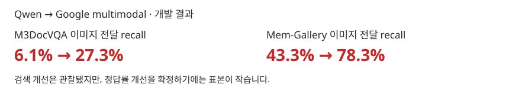

# Qwen 대신 Google 멀티모달 임베더를 쓰면 도움이 되는가?

**이미지 근거를 찾는 데는 도움이 됐다. 정답률도 올랐지만, 개선을 확정하기에는 표본이 작다.**

2026-10-13 · 개발 평가 완료: M3DocVQA 50문항, Mem-Gallery 10문항 × 3조건. 각 조건에서 문항당 한 번만 풀었다. 기존 혼합 임베더 결과는 포함하지 않았다.

## 1. 배경과 목적

A-RAG에서 기존 Qwen 임베더를 Google 임베더로 바꿀 때, 텍스트 임베더 교체 효과와 이미지 벡터 검색 추가 효과를 분리해 확인한다. Reader VLM과 검색·읽기 도구는 모두 같은 조건이다.

## 2. 방법

A-RAG의 **검색 → 근거 읽기 → 필요하면 재검색 → 답변** 과정을 사용한다. 검색된 캡션에 연결 이미지가 있으면 `read_chunk`를 통해 실제 이미지를 Reader VLM에 전달한다. 세 조건 모두 이 방식으로 이미지를 볼 수 있다.

| 조건 | 텍스트·캡션 임베딩 | 이미지 벡터 검색 |
|---|---|---|
| Qwen (B0) | Qwen3-Embedding-4B | 미사용; 캡션 검색 후 연결 이미지 열람 가능 |
| Google text-only (C1) | EmbeddingGemma 2 | 미사용; 캡션 검색 후 연결 이미지 열람 가능 |
| Google multimodal (G1) | EmbeddingGemma 2 | 같은 Google 임베더로 추가 검색 |

| 구성 | 공통 설정 |
|---|---|
| 기반 | A-RAG, 동일 프롬프트와 `keyword_search` / `semantic_search` / `read_chunk` |
| PDF 파서 | MinerU2.5-Pro-2604-1.2B, standard tier; 원문 캡션 유지 |
| Reader VLM | **Google Gemma 4 E4B-it** |
| 반복 | **A-RAG max iteration = 8**, 조기 종료 가능. 한도 도달 후 최종 답변 호출은 별도이며 Reader VLM에 독립적인 호출 횟수 제한 없음 |
| 생성·이미지 | temperature 0, seed 20261013, 출력 1,024 tokens, context 32,768, 이미지 최대 8개 |
| 검색 | 텍스트 후보 60개, 이미지 채널 사용 시 후보 60개, 기본 반환 5개. G1은 두 Google 순위를 RRF(k=60)로 결합; reranker 없음 |

세 조건의 질문·코퍼스·Reader 설정·프롬프트 해시 일치를 확인했다. Mem-Gallery는 모두 질문 텍스트만 입력하며, 검색된 대화 이미지는 정상 전달한다. 반복은 한 번의 풀이 안에서 수행하며, 오답 재시도나 best-of 선택은 하지 않았다.

## 3. 벤치마크 설명

| 벤치마크 | 과제 | 이번 평가 |
|---|---|---|
| M3DocVQA | 여러 Wikipedia PDF의 텍스트·표·이미지를 연결해 답변 | 이미지 관련 개발 50문항, 180문서 |
| Mem-Gallery | 과거 이미지 포함 대화에서 사진 찾기(VS) 또는 내용 추론(VR) | 개발 10문항: VS 5 + VR 5, 2개 시나리오 |

Mem-Gallery의 질문 첨부 이미지를 제외했으므로 공식 원형 그대로의 평가는 아니다. 추가 측정할 50문항씩은 기존 개발 문항과 겹치지 않는다. 추가 측정 결과는 완료 후 별도 표로 보완한다. 현재 표에는 기존 개발 결과만 포함했다.

## 4. 평가 결과

단위: %. EM은 정답 문자열 일치율, F1은 답변 토큰 중첩 점수다.

| 벤치마크 | 조건 | EM | F1 | 답변 판정 점수 | 이미지 전달 recall |
|---|---|---:|---:|---:|---:|
| M3DocVQA | Qwen | 0.0 | 3.0 | 0.0 | 6.1 |
| M3DocVQA | Google text-only | 2.0 | 5.6 | 2.0 | 6.1 |
| M3DocVQA | Google multimodal | 4.0 | 10.3 | 8.0 | 27.3 |
| Mem-Gallery | Qwen | 20.0 | 33.0 | 50.0 | 43.3 |
| Mem-Gallery | Google text-only | 20.0 | 40.1 | 55.0 | 48.3 |
| Mem-Gallery | Google multimodal | 30.0 | 48.7 | 55.0 | 78.3 |

**이미지 전달 recall = 실제 Reader VLM에 전달된 정답 이미지 수 ÷ 해당 문항의 정답 이미지 수.** 이 비율을 문항별로 계산해 평균했다. 한 번의 풀이 전체에서 전달된 이미지 ID를 중복 제거해 누적하며, 검색 한 번의 top-K recall이 아니다. 정답 이미지가 실제 Reader 입력까지 도달했는지를 측정한다.

M3 이미지 recall은 정답 이미지 대응이 검증된 **33문항**, 답변 점수는 전체 50문항 기준이다. Mem-Gallery recall은 10문항 기준이며 VS는 정답 이미지 ID, VR은 정답 근거 대화에 첨부된 이미지를 대상으로 한다. VR의 여러 첨부 이미지 각각에 대한 관련성은 별도로 주석되지 않았다. 검색 후보 recall은 진단용 원자료에만 보관한다.

답변 판정은 벤치마크별 채점 규칙을 적용했다. M3는 정오 판정, Mem-Gallery는 부분 점수를 포함한 공식 점수이므로 두 벤치마크의 판정 수치를 직접 비교하지 않는다.

Google multimodal의 Qwen 대비 EM 증가량은 M3 **+4%p**(새 정답 2개, 잃은 정답 0개), Mem-Gallery **+10%p**(새 정답 1개, 잃은 정답 0개)다. 문항별 paired bootstrap 95% 구간은 각각 0~10%p, 0~30%p이며 exact McNemar p값은 0.50, 1.00이다. **방향은 긍정적이지만 정답률 우위가 확정된 결과는 아니다.** Mem-Gallery는 시나리오도 2개뿐이다.

Google text-only는 M3 이미지 전달 recall을 바꾸지 못했다. 이번 표본에서는 텍스트 임베더만 교체하는 것보다 이미지 벡터 검색을 추가한 효과가 더 뚜렷했다.

## 5. 정성 평가

요청한 사례 형식은 **왼쪽: Qwen 실패 / 오른쪽: 같은 문항의 Google multimodal 성공**, 실제 전달 이미지와 답변 비교다.

현재는 전체 정답률 개선이 확정되지 않아 성공 사례 4개를 근거로 효과를 강조하지 않는다. EM 기준으로 조건을 만족하는 문항은 M3 2개, Mem-Gallery 1개여서 벤치마크별 2개씩 구성할 수도 없다. 사례를 만들기 위한 재풀이도 하지 않았다. 해당 문항 ID는 아래 비교 원자료에 보존했다.

## 6. 방향과 시사점

- **Google 멀티모달은 이미지 근거 검색에 유용하다.** Qwen과 섞지 않고 Google 텍스트·이미지 임베딩만 사용해도 두 개발 집합에서 이미지 recall이 높아졌다.
- **A-RAG에서는 찾은 이미지를 실제로 읽게 하는 단계가 중요하다.** M3의 후보 recall 81.8%에 비해 전달 recall은 27.3%다. 다음 개선 후보는 검색 결과의 이미지 연결 정보와 읽기 선택 방식이다. 이 변경의 효과는 아직 측정하지 않았다.
- **Reader의 정답 생성까지 개선됐다고 단정하지 않는다.** M3 EM은 여전히 4%다. 더 큰 새 문항 집합에서 같은 세 조건을 유지해 확인할 필요가 있다.

## 7. 참조 링크

- 결과 원자료: [M3DocVQA](three_arm_arag8/m3docvqa/) · [Mem-Gallery](three_arm_arag8/memgallery/). 조건별 점수·문항별 결과·실행 manifest·paired 비교 포함.
- 구현과 설정: [실험 계획](../../docs/EXPERIMENT_PLAN.md) · [실행 코드](../../scripts/run_three_arm_comparison.py) · [A-RAG](https://github.com/Ayanami0730/arag)
- 벤치마크: [M3DocVQA](https://github.com/bloomberg/m3docrag) · [Mem-Gallery](https://github.com/YuanchenBei/Mem-Gallery)
- 모델: [Qwen 임베더](https://huggingface.co/Qwen/Qwen3-Embedding-4B) · [Google 임베더](https://huggingface.co/google/embeddinggemma-2) · [Reader VLM](https://huggingface.co/google/gemma-4-E4B-it) · [MinerU 파서](https://huggingface.co/opendatalab/MinerU2.5-Pro-2604-1.2B)
