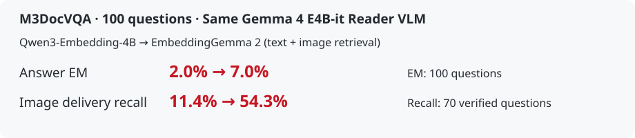
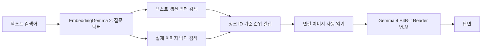
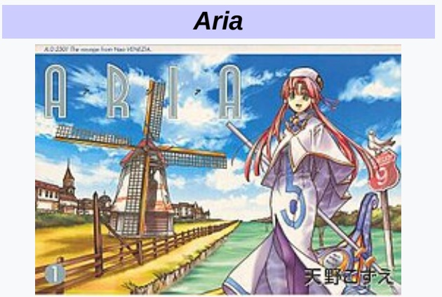
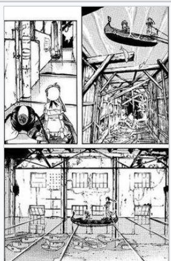
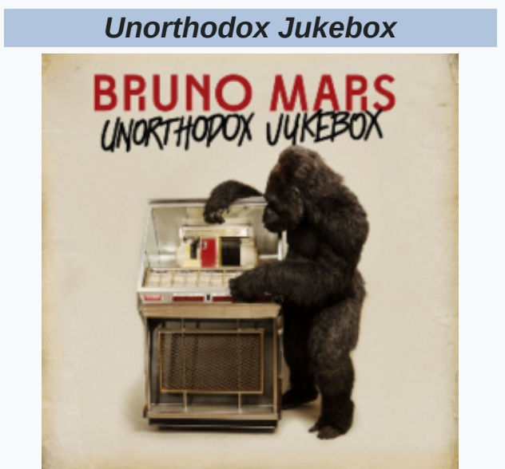
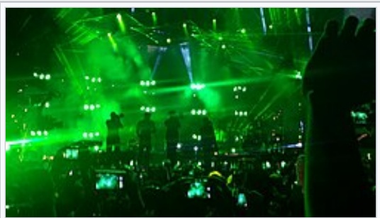
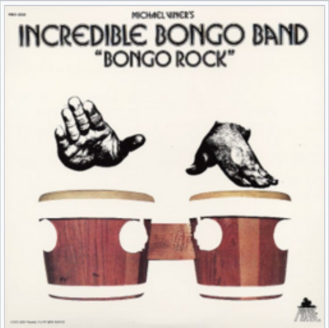

# Qwen3-Embedding-4B를 EmbeddingGemma 2로 바꾸면 도움이 되는가?

**M3DocVQA에서 이미지 전달 recall은 11.4%→54.3%, 정답률은 2%→7%였다. 문서 이미지 검색에는 유망하지만, 정답률 우위는 아직 확정하지 못했다.**

2026-10-14 문서 개정 · 2026-10-13 측정 결과 · **100문항 × 3조건 = 300회 풀이**. 이번 개정은 설명·구성 수정이며 추가 추론은 실행하지 않았다.



## 1. 배경과 목적

A-RAG의 검색용 임베더를 **Qwen3-Embedding-4B**에서 **EmbeddingGemma 2**로 바꾸었을 때 근거 검색과 답변이 개선되는지 확인한다. EmbeddingGemma 2의 텍스트 검색만 사용하는 조건과 실제 이미지 벡터도 검색하는 조건을 비교했다.

## 2. 방법

### 임베더와 Reader VLM의 역할

| 역할 | 정확한 모델명 | 입력 → 출력 |
|---|---|---|
| 기준 검색용 임베더 | **Qwen3-Embedding-4B** (`Qwen/Qwen3-Embedding-4B`) | 텍스트 → 검색 벡터 |
| 비교 검색용 임베더 | **EmbeddingGemma 2** (`google/embeddinggemma-2`) | 텍스트 또는 실제 이미지 → 공통 768차원 검색 벡터 |
| 답변용 Reader VLM | **Gemma 4 E4B-it** (`google/gemma-4-E4B-it`) | 질문 + 검색된 근거 텍스트·실제 이미지 → 답변 |

**EmbeddingGemma 2는 근거를 찾는 임베더이고, Gemma 4 E4B-it은 근거를 읽고 답하는 Reader VLM이다.** Reader VLM은 세 조건에서 동일하다. 공식 임베더 명칭은 ‘Gemma 임베더 2’가 아닌 **EmbeddingGemma 2**다. [공식 모델 설명](https://huggingface.co/google/embeddinggemma-2/blob/914f7f89142e33e77833254d9c9b90c3cef7303b/README.md)

### 비교 조건 — 바뀌는 것은 검색용 임베더와 이미지 검색 채널

| 조건 | 텍스트·캡션 벡터 검색 | 실제 이미지 벡터 검색 | 검색된 실제 이미지 → Reader |
|---|---|---|---|
| B0 · Qwen3-Embedding-4B | 사용 | 사용하지 않음 | 자동 전달 |
| C1 · EmbeddingGemma 2 텍스트 검색 | 사용 | 사용하지 않음 | 같은 자동 전달 |
| G1 · EmbeddingGemma 2 텍스트+이미지 검색 | 사용 | **사용** | 같은 자동 전달 |

- **B0 ↔ C1:** 텍스트 검색 임베더 교체 비교.
- **C1 ↔ G1:** 같은 EmbeddingGemma 2에 **이미지 벡터 검색을 추가한 효과** 비교. 서로 다른 두 모델을 조합한 조건이 아니다.
- 이미지 벡터만 사용하는 조건은 별도로 측정하지 않았다. Qwen3-Embedding-4B와 EmbeddingGemma 2를 혼합하지 않았다.

### 텍스트 질문으로 어떻게 이미지를 찾는가?

**G1은 텍스트 검색어를 EmbeddingGemma 2로 벡터화한 뒤, 그 벡터로 텍스트 인덱스와 실제 이미지 인덱스를 모두 검색한다.** 질문 이미지를 넣거나 검색 전에 이미지 캡션을 새로 생성할 필요가 없다. 텍스트와 이미지가 같은 의미 벡터 공간에 정렬되어 있어 교차 모달 유사도를 계산할 수 있다. [모델 설명](https://huggingface.co/google/embeddinggemma-2/blob/914f7f89142e33e77833254d9c9b90c3cef7303b/README.md)



A-RAG가 만든 검색어를 위 경로로 처리한다. 텍스트 후보와 이미지 후보를 RRF(k=60)로 결합해 기본 상위 5개 청크를 반환한다. **임베더가 풍차라는 답을 생성한 것이 아니라**, 표지를 검색한 뒤 Reader VLM이 실제 표지를 보고 답한 것이다.

### 질문 이미지·캡션 사용 여부

| 자료 | 검색에서 사용 | Reader VLM에서 사용 |
|---|---|---|
| 질문 원문 텍스트 | 사용 | 사용 |
| 질문 첨부 이미지와 그 캡션 | **모두 제외** | **모두 제외** |
| 검색 대상 문서의 텍스트·기존 캡션·주석 | 세 조건 모두 사용 | 읽은 근거 원문으로 사용 |
| 검색 대상의 실제 이미지 | G1만 벡터 검색에 사용 | **세 조건 모두 검색 결과에 연결되면 자동 입력** |

Qwen3-Embedding-4B도 이미지 연결 청크를 텍스트·캡션 검색으로 찾으면 Reader에 실제 이미지를 전달한다. **텍스트 검색 조건이라는 말은 Reader가 이미지를 못 본다는 뜻이 아니다.**

### 공통 설정

| 항목 | 세 조건 공통 설정 |
|---|---|
| 기반·도구 | A-RAG; keyword_search / semantic_search / read_chunk, 같은 프롬프트 |
| PDF 파서 | MinerU2.5-Pro-2604-1.2B, standard tier; 기존 캡션·주석 보존, 둘 다 없으면 주변 문서 텍스트 사용 |
| 반복 | **A-RAG max iteration = 8**, 조기 종료 가능. 한도 후 최종 답변 호출은 별도이며 Reader 호출 횟수에 독립적 제한 없음 |
| Reader 생성·입력 | temperature 0, seed 20261013, 출력 최대 1,024 tokens, context 32,768, 고유 근거 이미지 최대 8개 |
| 검색 후보 | 텍스트: 상위 180개 문장 후보에서 최대 60청크. 이미지: 최대 60청크. 기본 반환 5개, reranker 없음 |

같은 질문·288문서 코퍼스·Reader·프롬프트·전달 정책을 사용했다. 사용자 승인된 재측정에서 조건별 문항당 한 번만 풀었으며, 오답 재시도·best-of·정답 근거 직접 제공은 없다. 기존 인덱스를 재사용했다.

## 3. 벤치마크 설명

**M3DocVQA**는 Wikipedia 문서의 텍스트·표·이미지를 연결해 답하는 문서 질의응답 벤치마크다. 이번에는 기존에 고정한 이미지 관련 **100문항과 288문서 코퍼스**를 사용했다. 전체 공개 문서 집합을 사용하는 공식 open-domain 평가와 직접 비교할 수 없다. [벤치마크](https://github.com/bloomberg/m3docrag) · [문항 선정 기록](../registry/search_linked100_selection.json)

## 4. 평가 결과

각 조건 100문항 · 단위 % · 임베더 이외 Reader 설정 동일.

| 검색 조건 | 정답률 EM ↑ | F1 ↑ | 이미지 전달 recall ↑ |
|---|---:|---:|---:|
| B0 · Qwen3-Embedding-4B | 2.0 | 5.0 | 11.4 |
| C1 · EmbeddingGemma 2 텍스트 검색 | 0.0 | 3.9 | 11.4 |
| G1 · EmbeddingGemma 2 텍스트+이미지 검색 | **7.0** | **13.5** | **54.3** |
| **G1 − B0 차이 (%p)** | **+5.0** | **+8.5** | **+42.9** |

- **EM:** 정규화한 최종 답변의 정확 일치율. **F1:** 답변과 정답의 토큰 겹침 점수. 둘 다 100문항으로 계산했다.
- **이미지 전달 recall:** 문항별로 `실제 Reader에 전달된 고유 정답 이미지 수 / 정답 이미지 수`를 계산한 뒤 평균했다. 한 번의 풀이 전체 기준이며, 마지막 검색의 top-K recall이 아니다. 이미지 대응을 완전히 검증한 **70/100문항**으로 계산하고, 나머지 30문항은 제외했다.

**텍스트 임베더 교체만으로는 개선되지 않았고, 이미지 검색 채널을 추가한 G1에서 개선됐다.** G1은 B0 대비 오답→정답 6개, 정답→오답 1개였다. EM 차이의 대응 bootstrap 95% 구간은 **0~+10%p**, McNemar p=0.125다. 따라서 정답률 우위는 확정하지 못했다.

검색 도구가 반환한 이미지 연결 결과의 **전달 누락은 300회 모두 0건**이었다. 이미지 예산 초과·전송 실패·종료 시 대기 이미지도 없었다. 찾은 이미지를 전달하는 경로는 작동했지만, 여전히 검색 실패와 Reader의 해석·답변 오류가 남아 있다. [요약·문항별 지표·실행 manifest·전달 감사](search_linked100/m3docvqa/)

## 5. 정성 평가

이번 실행의 **B0 오답 → G1 정답** 사례 두 개다. 왼쪽·오른쪽은 같은 문제와 같은 Reader VLM이며, 각 열에 실제 전달된 이미지를 한 장씩 세로로 표시했다. C1도 두 문제 모두 오답이었다.

### 1. 캡션 없는 표지의 물체 식별

**문제:** Aria 표지의 왼쪽 가운데에 있는 큰 물체는? **정답:** windmill

**질문 입력:** 원래 질문 첨부 이미지·그 캡션 모두 없음, 세 조건 모두 텍스트만 입력. **검색 대상:** 정답 표지의 구조화된 캡션·주석은 없지만 주변 문서 텍스트는 검색에 사용했다. 표지 픽셀 안의 인쇄 제목도 존재한다.

<table>
<tr><th width="50%">B0 · Qwen3-Embedding-4B<br>텍스트 검색 — 실패</th><th width="50%">G1 · EmbeddingGemma 2<br>텍스트+이미지 검색 — 성공</th></tr>
<tr><td width="50%" valign="top"><p><strong>답변: 빈 답변 []</strong></p><p>Reader 입력 이미지: 0개</p><p>이미지 연결 청크가 반환되지 않아<br>실제 이미지 입력 없음</p><p><strong>대신 읽은 근거</strong><br>“Aria is large and fat, massing 10 kg.”<br>고양이 설명 본문이며 이미지 연결 없음</p></td><td width="50%" valign="top"><p><strong>답변: A windmill</strong></p><p>Reader 입력 이미지: 2개</p><p><a href="qualitative_cases/aria-windmill/images/b3e17b3a5c73a10c98ec0874.jpg"></a><br>근거 이미지 1</p><p><a href="qualitative_cases/aria-windmill/images/b6dbe6b94be9c2125eab8571.jpg"></a><br>근거 이미지 2</p></td></tr>
</table>

세 조건 모두 `large object in the middle left of Aria manga`로 검색했다. **B0는 Aria 문서 자체는 찾았지만 표지 이미지 청크를 상위 5개에 넣지 못했다.** 대신 “Aria는 크고 뚱뚱한 고양이”라는 본문을 검색해 읽었다. C1도 같은 본문을 읽고 답을 내지 못했다.

표지에 연결된 검색 텍스트에는 “Aria 1권 표지”라는 주변 설명이 있지만 풍차·왼쪽 물체에 관한 설명은 없다. 이 때문에 텍스트 검색이 불리했던 것으로 해석된다. **G1은 표지 청크를 결합 검색 결과 1위로 반환**했고 실제 표지가 Reader에 들어가 “A windmill”이라고 맞혔다. 개별 이미지 채널의 순위·유사도는 실행 trace에 저장되지 않았으므로, 이미지 검색 단독 1위였다고 단정하지 않는다.

[원본 질문·정답·캡션·이미지·세 조건 전체 실행](qualitative_cases/aria-windmill/README.md)

### 2. 고릴라가 등장하는 앨범 표지 찾기

**문제:** 2012년 12월 앨범 목록 중 표지에 고릴라가 있는 앨범은? **정답:** Unorthodox Jukebox

**질문 입력:** 원래 질문 첨부 이미지·그 캡션 모두 없음, 세 조건 모두 텍스트만 입력. **검색 대상:** 정답 표지의 구조화된 캡션·주석은 없지만 주변 문서 텍스트는 검색에 사용했다. 표지 픽셀 안의 인쇄 제목도 존재한다.

<table>
<tr><th width="50%">B0 · Qwen3-Embedding-4B<br>텍스트 검색 — 실패</th><th width="50%">G1 · EmbeddingGemma 2<br>텍스트+이미지 검색 — 성공</th></tr>
<tr><td width="50%" valign="top"><p><strong>답변: 빈 답변 []</strong></p><p>Reader 입력 이미지: 0개</p><p>이미지 연결 청크가 반환되지 않아<br>실제 이미지 입력 없음</p></td><td width="50%" valign="top"><p><strong>답변: Unorthodox Jukebox</strong></p><p>Reader 입력 이미지: 3개</p><p><a href="qualitative_cases/gorilla-album/images/f85aa12b8c7979ee6dc08019.jpg"></a><br>근거 이미지 1</p><p><a href="qualitative_cases/gorilla-album/images/83c941492eff5e3348473225.jpg"></a><br>근거 이미지 2</p><p><a href="qualitative_cases/gorilla-album/images/b44d762bf12ea15aead871e4.jpg"></a><br>근거 이미지 3</p></td></tr>
</table>

B0와 C1은 정답 표지를 입력받지 못했다. G1은 실제 표지를 포함한 3개 이미지를 검색·전달했고 Reader가 “Unorthodox Jukebox”라고 맞혔다. 구조화된 캡션이 없어도 이미지 벡터 검색이 근거 확보에 도움이 된 사례다.

[원본 질문·정답·캡션·이미지·세 조건 전체 실행](qualitative_cases/gorilla-album/README.md)

## 6. 방향과 시사점

**EmbeddingGemma 2의 텍스트+이미지 검색을 문서 이미지 RAG의 도입 후보로 추천한다.** 텍스트 임베더만 바꾸기보다 이미지 인덱스와 실제 이미지 전달까지 연결하는 것이 이번 비교에서 효과적이었다. 다만 EM은 7%이고 정답률 차이의 불확실성이 있어, 전면 교체보다는 제한된 적용에서 추가 검증하는 것이 적절하다.

검색된 이미지의 자동 전달은 유지하고, 다음에는 검색 정밀도와 Reader의 근거 해석·답 형식을 개선할 수 있다. 이러한 추가 개선 효과는 아직 측정하지 않았다. 구현에 필요한 수정은 아래 부록 A에, 임베더 구조와 원리는 부록 B에 정리했다.

## 7. 참조 링크

- 측정: [M3DocVQA 결과·manifest](search_linked100/m3docvqa/) · [Aria 원자료](qualitative_cases/aria-windmill/README.md) · [앨범 원자료](qualitative_cases/gorilla-album/README.md)
- 구현: [전체 구현 명세](../../docs/IMPLEMENTING_GOOGLE_MULTIMODAL_EMBEDDING.md) · [실행 코드](../../scripts/run_three_arm_comparison.py) · [A-RAG 원본](https://github.com/Ayanami0730/arag)
- 모델·벤치마크: [EmbeddingGemma 2 공식 모델 설명](https://huggingface.co/google/embeddinggemma-2/blob/914f7f89142e33e77833254d9c9b90c3cef7303b/README.md) · [Qwen3-Embedding-4B](https://huggingface.co/Qwen/Qwen3-Embedding-4B) · [Gemma 4 E4B-it Reader VLM](https://huggingface.co/google/gemma-4-E4B-it) · [M3DocVQA](https://github.com/bloomberg/m3docrag)

## 부록 A. EmbeddingGemma 2를 사용하기 위한 A-RAG 수정

### A.1. 수정해야 하는 경로

| 단계 | 파일 | 구현 내용 |
|---|---|---|
| 문서 표현 | [ir.py](../../src/lsdrag/ir.py) | 텍스트·이미지 청크와 figure_id, chunk_id, 실제 이미지 경로 연결. 기존 캡션·주석 유지; 없으면 주변 텍스트 사용 |
| 임베딩 | [embeddings.py](../../src/lsdrag/embeddings.py) | EmbeddingGemma 2 고정 revision 로드, 질문·문서 prefix 처리, PIL RGB 이미지 인코딩, 768차원 float32 L2 정규화 |
| 인덱스 | [index.py](../../src/lsdrag/index.py) | 텍스트 문장 벡터와 실제 이미지 벡터를 별도 저장. 이미지에는 원본 figure_id와 부모 chunk_id 보존 |
| 검색 | [retrieval.py](../../src/lsdrag/retrieval.py) | 같은 텍스트 질문 벡터로 두 인덱스 검색, 청크 단위 중복 제거·RRF 결합, top-K 반환 |
| 자동 읽기 | [context.py](../../src/lsdrag/context.py) | 반환된 이미지 연결 청크를 read_search_images()로 읽고 실제 파일을 전송 큐에 넣음 |
| Reader 입력 | [agent.py](../../src/lsdrag/agent.py) | 다음 Reader 요청에 실제 image_url 이미지 블록 추가; 성공 응답 후에만 delivered 기록 |
| 공정 비교·로그 | [run_experiment.py](../../scripts/run_experiment.py) | 세 조건 모두 search-linked 정책, 같은 프롬프트·Reader·max iteration, 질문·정답 분리와 manifest 기록 |

### A.2. 인코딩·검색 계약

```python
# 개념 코드. 실제 구현은 위 파일을 따른다.
q = embedder.encode([search_query], role="query")[0]   # (768,)
t = text_index.search(q, limit=60, row_limit=180)
i = image_index.search(q, limit=60)                   # 같은 q로 이미지 검색
ranked = reciprocal_rank_fusion([chunk_ids(t), chunk_ids(i)], k=60)
results = snippets(ranked[:5])
results = context.read_search_images(results, "semantic_search")
# 다음 정상 Reader 요청에 context의 실제 이미지 블록을 함께 넣는다.
```

질문은 `task: search result | query: {검색어}`, 문서는 `title: {제목} | text: {내용}`으로 인코딩한다. 이미지는 실제 RGB 픽셀을 인코딩하고 텍스트 prefix를 붙이지 않는다. 문서 캡션 벡터와 이미지 픽셀 벡터는 **별도 인덱스**이며, 캡션과 이미지를 하나의 입력으로 합쳐 만든 벡터를 이번 실험에 사용한 것은 아니다. [현재 어댑터](../../src/lsdrag/embeddings.py)

두 채널은 원시 유사도 점수를 더하지 않고 **순위**를 합친다. 청크 c의 RRF 점수는 `Σ 1 / (60 + 해당 채널의 순위)`다. 이미지 검색 결과도 부모 chunk_id로 바꿔 텍스트 결과와 같은 단위로 결합한다. C1은 위 이미지 검색·결합 부분을 실행하지 않는다. [검색 구현](../../src/lsdrag/retrieval.py)

### A.3. Reader에 실제 이미지를 넣는 조건

검색 도구가 반환한 청크의 figure_ids만 따라 실제 이미지를 읽는다. 코퍼스 전체나 정답 이미지 목록을 자동으로 넣지 않는다. 캡션이나 파일 경로만 Reader에 주는 것으로 끝내지 않고, tool 결과 뒤 user 메시지에 `image_url` 데이터 블록을 추가한다. 파일 해시로 중복을 제거하고 풀이당 고유 이미지 최대 8개를 유지한다.

이 자동 읽기는 도구 내부 처리이므로 별도 A-RAG iteration이나 Reader 호출을 추가하지 않는다. A-RAG max iteration 8과 최종 답변 호출 규칙을 유지한다. 전달 성공 기록은 Reader가 이미지 포함 요청에 정상 응답한 다음 남긴다. B0·C1·G1에 모두 같은 정책을 적용해야 비교가 공정하다.

### A.4. 실행·검증 시 고정할 사항

- 임베더 revision: `914f7f89142e33e77833254d9c9b90c3cef7303b`. 오디오 인코더는 제외(`audio_config=None`), 비전 인코더는 유지한다. C1도 같은 어댑터를 로드하지만 이미지 인덱스는 검색하지 않는다.
- 임베딩 계산 dtype은 GPU bfloat16 또는 CPU float32. 저장 벡터는 유한한 float32, 768차원, L2 정규화. float16·차원 축소는 이번 조건에 사용하지 않았다.
- 테스트는 텍스트 검색으로 찾은 이미지의 실제 전달, 세 조건의 같은 정책, 중복·예산 처리, iteration 한도 후 최종 호출을 확인한다. 기존 소프트웨어 테스트 42개가 통과했다.
- 실행 manifest에는 모델·인덱스·입력·프롬프트·정책·코드 해시를 남기고, trajectory·evidence_events·delivered_figure_ids로 실제 전달을 확인한다. 완료된 문항을 새 승인 없이 반복하지 않는다.

설치 환경, 명령과 오류 처리까지 포함한 [전체 구현 명세](../../docs/IMPLEMENTING_GOOGLE_MULTIMODAL_EMBEDDING.md)를 함께 사용한다.

## 부록 B. EmbeddingGemma 2의 구조와 검색 원리

### B.1. 모델 구조

EmbeddingGemma 2는 Gemma 4 계열의 **임베딩 모델**이다. 텍스트·이미지·영상·오디오를 공통 768차원 공간으로 변환한다. 전체 740M 파라미터 중 텍스트 부분은 270M, 비전 인코더는 170M, 오디오 인코더는 300M이다. 이번 실험은 오디오를 제외한 텍스트+비전 구성이다. [공식 모델 설명](https://huggingface.co/google/embeddinggemma-2/blob/914f7f89142e33e77833254d9c9b90c3cef7303b/README.md)

| 구성 | 고정 체크포인트의 설정 | 의미 |
|---|---|---|
| 텍스트 backbone | 24층, hidden 512, FFN 2,048, attention head 4 | 입력 토큰의 문맥 표현 계산 |
| 어텐션 배치 | local 5층 + global 1층을 4번 반복; local KV head 2, global 1 | 가까운 문맥 처리와 전체 문맥 결합 |
| 비전 인코더 | 16층, hidden 768, head 12, patch size 16 | 이미지 패치를 시각 토큰으로 변환 |
| 비전→텍스트 연결 | 시각 특징을 텍스트 backbone 입력 공간으로 투영 | 이미지도 공통 backbone에서 처리 |
| 출력 | 토큰 표현 512→768 투영, mean pooling, 정규화 | 입력당 검색 벡터 하나 생성 |
| 임베더 입력 한도 | 공식 사용 한도 8,192 tokens; 이미지 기본 soft token 280개 | Reader의 context 32,768·이미지 soft token 1,120 설정과 별개 |

세부 값은 실행에 사용한 [고정 모델 설정 사본](assets/embeddinggemma2/config.json)과 [pooling 설정](assets/embeddinggemma2/pooling_config.json), 로컬 Transformers 구현을 확인했다. 모델 카드에는 sliding window 1,024라고 쓰여 있지만 **고정 config의 text_config.sliding_window는 512**다. 재현 시 카드의 요약값으로 덮어쓰지 말고 체크포인트 설정을 따른다. config의 max_position_embeddings 값이 크더라도 공식 8,192 입력 한도를 늘린 근거로 사용하지 않는다. [원본 설정 위치·해시](assets/embeddinggemma2/provenance.json)

### B.2. 텍스트와 이미지가 같은 벡터가 되는 과정

1. **텍스트 경로:** 검색어 토큰화 → 토큰 임베딩 → 텍스트 backbone → 768차원 토큰 표현 → 평균 → 정규화.
2. **이미지 경로:** 이미지 전처리·패치화 → 비전 인코더 → 텍스트 입력 공간으로 투영 → 같은 backbone과 출력 처리 → 768차원 정규화 벡터.
3. **검색 단계:** 정규화한 질문 벡터 q와 저장 벡터 v의 내적 `q·v`를 계산한다. 두 벡터의 길이가 1이므로 코사인 유사도와 같다.

모달리티 사이의 표현 정렬은 모델이 짝지어진 자료로 학습한 성질이다. 768차원이라는 크기만 같다고 정렬되는 것은 아니다. 따라서 Qwen3-Embedding-4B 질문 벡터로 EmbeddingGemma 2 이미지 벡터를 직접 검색하지 않는다. [학습 자료의 교차 모달 구성 설명](https://huggingface.co/google/embeddinggemma-2/blob/914f7f89142e33e77833254d9c9b90c3cef7303b/README.md)

이는 동작 경로를 설명한 것으로, 공개 모델 카드에 없는 세부 학습 손실이나 음성·영상 학습 절차를 추정해 단정한 것은 아니다. 이번 실험은 학습을 새로 하지 않고 고정 모델로 인코딩·검색했다.

### B.3. ‘텍스트+이미지 검색’의 정확한 의미

모델은 텍스트와 이미지를 섞은 입력도 지원하지만, **이번 G1은 텍스트 벡터와 이미지 벡터를 따로 저장하고 검색 순위를 결합**한다. 질문은 끝까지 텍스트 입력이다. Reader VLM은 검색 후 실제 이미지를 받는다. 따라서 아래 세 가지는 서로 구별해야 한다.

| 표현 | 이번 실험에서의 의미 |
|---|---|
| 멀티모달 임베더 | 텍스트·실제 이미지 모두를 공통 벡터 공간에 인코딩하는 EmbeddingGemma 2 |
| 텍스트+이미지 검색 | 텍스트 검색어 벡터로 텍스트 인덱스와 이미지 인덱스를 모두 조회하는 G1 설정 |
| Reader VLM | 검색된 근거 이미지·텍스트를 읽고 답을 생성하는 별도 모델 Gemma 4 E4B-it |

### B.4. 차원 축소와 현재 결과의 범위

EmbeddingGemma 2는 MRL로 768차원 벡터의 앞 512·256·128차원을 사용하는 방식을 지원한다. 축소 후에는 다시 정규화해야 한다. 이번 비교는 **768차원 전체**만 사용했으므로 차원 축소의 속도·저장량·정확도 효과는 위 결과로 판단하지 않는다. [공식 사용 지침](https://huggingface.co/google/embeddinggemma-2/blob/914f7f89142e33e77833254d9c9b90c3cef7303b/README.md)
