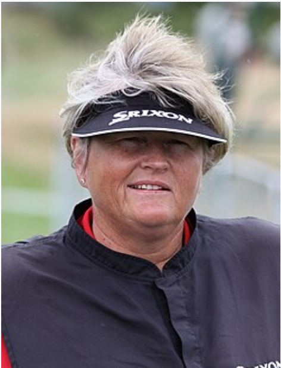
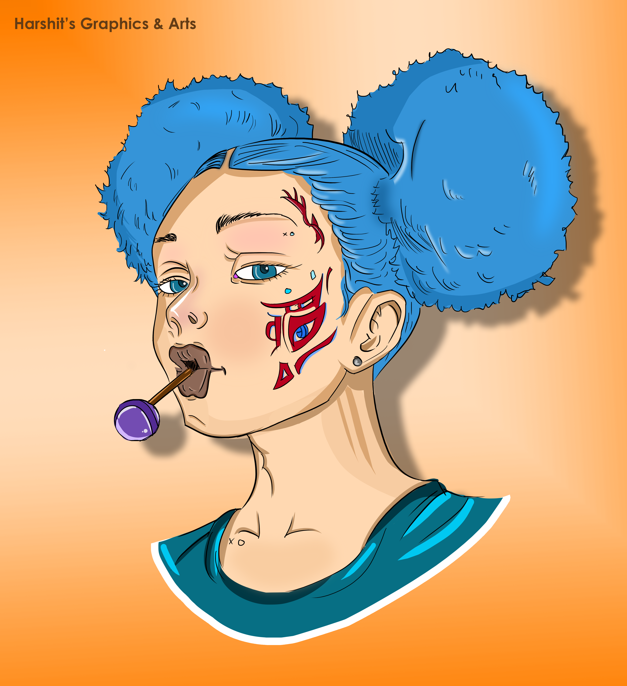
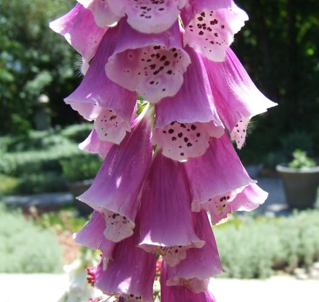
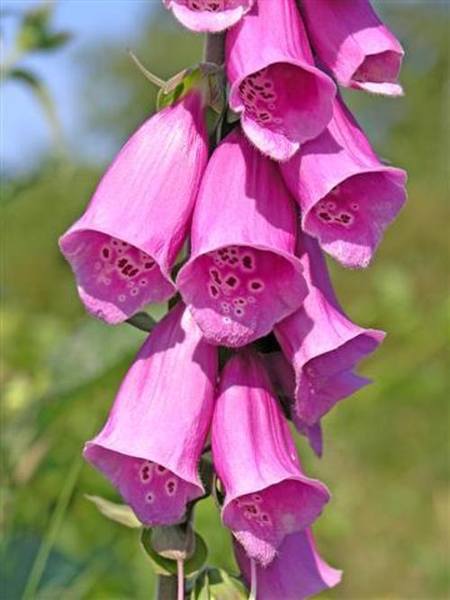
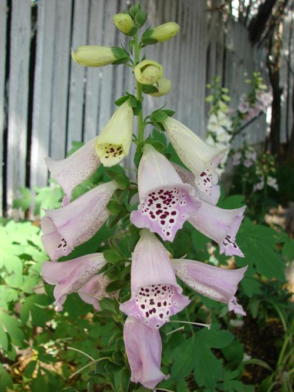

# Qwen 대신 Google 멀티모달 임베더를 쓰면 도움이 되는가?

**문서 이미지가 중요한 RAG에서는 도입 후보로 추천한다. 대화 기억 검색의 효과는 제한적이며, 정답률 우위는 아직 확정하지 못했다.**

2026-10-13 업데이트. 기존 결과에 새 M3DocVQA 50문항과 Mem-Gallery 50문항을 추가했다. 누적 고유 문항은 각각 100개·60개이며, 세 조건에서 문항당 한 번씩만 풀었다. 총 480회 풀이에 실행 오류는 없었다.

**측정 당시 전달 정책:** 검색 결과의 이미지 청크를 에이전트가 `read_chunk`로 선택해야 실제 이미지가 Reader에 들어갔다(`agent-read`). **현재 수정한 정책:** 반환된 이미지 연결 청크를 자동 읽기해 Reader에 전달한다(`search-linked`, 세 조건 공통). 아래 수치는 수정 전 측정이며, 자동 전달 수정 후 성능은 아직 측정하지 않았다.

## 1. 배경과 목적

A-RAG에서 Qwen 임베더를 Google 임베더로 바꿀 때 얻는 효과를 확인한다. 텍스트 임베더만 교체한 조건과 이미지 벡터 검색을 추가한 조건을 비교하고, Reader VLM과 검색·읽기 도구는 동일하게 유지한다.

## 2. 방법

A-RAG는 검색과 근거 읽기를 반복해 답한다. **Reader VLM은 세 조건 모두 실제 근거 이미지를 입력받을 수 있다.** 측정 당시에는 에이전트가 이미지 연결 청크를 읽기로 선택한 경우에만 전달했다. 검색에 걸리고도 읽지 않은 사례가 있어, 현재 코드는 그 선택을 기다리지 않고 반환된 이미지 연결 청크를 공통 이미지 예산 안에서 자동 읽도록 수정했다.

| 자료 종류 | 검색에서 사용 | Reader VLM에서 사용 |
|---|---|---|
| 질문 원문 텍스트 | 검색어 생성·임베딩에 사용 | 사용 |
| 원래 질문 첨부 이미지·그 이미지의 캡션 | 이번 비교에서는 제외 | 제외 |
| 검색 대상 자료의 텍스트·이미지 캡션·주석 | 세 조건 모두 검색 텍스트로 사용 | 읽은 청크의 원문으로 사용 |
| 검색 대상 자료의 실제 이미지 | G1만 이미지 벡터 검색 추가 | **세 조건 모두 사용**. 측정 당시에는 에이전트 선택 후, 수정 코드에서는 검색 연결 이미지 자동 읽기 후 입력 |

따라서 **질문 이미지·그 캡션을 제외한 것**과 **검색한 근거 이미지·그 캡션을 사용하는 것**은 서로 다른 조건이다.

| 조건 | 검색용 텍스트·캡션 임베더 | 검색용 실제 이미지 임베더 | Reader의 근거 이미지 입력 |
|---|---|---|---|
| Qwen (B0) | Qwen3-Embedding-4B | 사용하지 않음 | 지원, 공통 전달 정책 |
| Google text-only (C1) | EmbeddingGemma 2 | 사용하지 않음 | 지원, 공통 전달 정책 |
| Google multimodal (G1) | EmbeddingGemma 2 | 같은 EmbeddingGemma 2 | 지원, 공통 전달 정책 |

| 구성 | 공통 설정 |
|---|---|
| 기반·도구 | A-RAG, 같은 프롬프트와 `keyword_search` / `semantic_search` / `read_chunk` |
| PDF 파서 | MinerU2.5-Pro-2604-1.2B, standard tier; 원문 캡션·주석 유지. 둘 다 없으면 주변 문서 텍스트 사용 |
| Reader VLM | **Google Gemma 4 E4B-it** |
| 반복 | A-RAG max iteration = 8, 조기 종료 가능. 한도 도달 후 최종 답변 호출은 별도이며 Reader VLM에 독립적인 호출 횟수 제한 없음 |
| 생성·입력 | temperature 0, seed 20261013, 출력 1,024 tokens, context 32,768, 풀이당 고유 이미지 최대 8개 |
| 검색 | 텍스트 후보 60개, 이미지 채널 사용 시 후보 60개, 기본 반환 5개. G1은 Google 텍스트·이미지 순위를 RRF(k=60)로 결합. reranker 없음 |

질문·코퍼스·프롬프트·Reader 설정과 전달 정책은 각 평가 집합의 세 조건에서 같다. Mem-Gallery의 첫 질문 입력은 원문 텍스트이고, 이후 Reader는 읽은 근거의 텍스트·캡션·실제 이미지를 받는다. 오답 재시도나 best-of 선택은 하지 않았다. [현재 자동 전달 코드의 상세 구현 문서](../../docs/IMPLEMENTING_GOOGLE_MULTIMODAL_EMBEDDING.md)를 별도로 제공한다.

## 3. 벤치마크 설명

| 벤치마크 | 과제 | 기존 / 추가 평가 |
|---|---|---|
| M3DocVQA | Wikipedia PDF의 텍스트·표·이미지를 연결해 답변 | 기존 개발 50문항·180문서 / 새 50문항·사전 고정 288문서 |
| Mem-Gallery | 과거 이미지 포함 대화에서 사진 찾기(VS) 또는 내용 추론(VR) | 기존 개발 10문항·2개 시나리오 / 새 50문항(VS 25 + VR 25)·17개 시나리오 |

추가 문항은 결과를 보기 전에 고정했으며 기존 문항과 겹치지 않는다. M3DocVQA는 코퍼스 크기가 달라 기존·추가 결과를 분리했다. 전체 공개 문서 집합을 쓰는 공식 open-domain 설정과 직접 비교할 수 없다. Mem-Gallery는 해당 시나리오의 전체 대화를 검색하며, 질문 이미지를 제외한 사용자 요청의 text-query 비교다.

## 4. 평가 결과

**추가 50문항씩의 결과** · 단위: %.

| 벤치마크 | 조건 | EM | F1 | 이미지 전달 recall |
|---|---|---:|---:|---:|
| M3DocVQA | Qwen | 2.0 | 4.0 | 8.1 |
| M3DocVQA | Google text-only | 2.0 | 6.4 | 16.2 |
| M3DocVQA | Google multimodal | 8.0 | 13.8 | 32.4 |
| Mem-Gallery | Qwen | 28.0 | 37.8 | 52.1 |
| Mem-Gallery | Google text-only | 26.0 | 35.5 | 50.9 |
| Mem-Gallery | Google multimodal | 32.0 | 43.5 | 52.2 |

**EM**은 정규화한 정답 문자열의 일치율, **F1**은 답변과 정답의 토큰 중첩 점수다. 모델의 답변 판정 점수는 본문 표에서 제외했다.

**이미지 전달 recall = 실제 Reader VLM에 전달된 정답 이미지 수 ÷ 해당 문항의 정답 이미지 수.** 문항별 비율의 평균이다. 한 번의 풀이 전체에서 중복을 제거해 누적하며, 검색 한 번의 `recall@K`가 아니다. 같은 원본 이미지의 여러 PDF crop은 하나의 정답 이미지로 취급한다.

M3DocVQA의 EM·F1은 50문항, 이미지 recall은 원본 이미지와 PDF crop 대응을 검증한 37문항 기준이다. Mem-Gallery는 50문항 기준이며 VS는 정답 이미지 ID, VR은 정답 근거 대화에 첨부된 이미지를 대상으로 한다. VR의 여러 첨부 이미지 각각에 대한 관련성은 별도로 주석되지 않았다.

Google multimodal의 Qwen 대비 EM 차이는 M3DocVQA +6%p(새 정답 3개·잃은 정답 0개), Mem-Gallery +4%p(새 정답 4개·잃은 정답 2개)다. 문항별 paired bootstrap 95% 구간은 각각 0~14%p, −6~14%p이며 exact McNemar p값은 0.25, 0.69다. **정답률 개선은 관찰됐지만 통계적으로 확정되지 않았다.**

기존 개발 결과는 다음과 같다. Mem-Gallery에서 처음 관찰한 큰 전달 recall 개선이 추가 표본에서는 유지되지 않았으므로, 처음 10문항만으로 일반화하면 안 된다.

| 기존 개발 집합 | 조건 | EM | F1 | 이미지 전달 recall |
|---|---|---:|---:|---:|
| M3DocVQA 50문항 | Qwen | 0.0 | 3.0 | 6.1 |
| M3DocVQA 50문항 | Google text-only | 2.0 | 5.6 | 6.1 |
| M3DocVQA 50문항 | Google multimodal | 4.0 | 10.3 | 27.3 |
| Mem-Gallery 10문항 | Qwen | 20.0 | 33.0 | 43.3 |
| Mem-Gallery 10문항 | Google text-only | 20.0 | 40.1 | 48.3 |
| Mem-Gallery 10문항 | Google multimodal | 30.0 | 48.7 | 78.3 |

기존 M3DocVQA 이미지 recall의 분모는 33문항이다. 후보 recall은 검색·읽기 누락을 진단하는 원자료에만 보관한다.

## 5. 정성 평가

측정 당시 `agent-read` 정책의 동일 문항을 **왼쪽 Qwen 실패 / 오른쪽 Google multimodal 성공**으로 비교했다. 아래 이미지는 **검색 후 실제 Reader에 전달한 근거 이미지**다. 네 사례 모두 EM 기준으로 Qwen은 틀리고 Google multimodal은 맞았다. 개별 사례가 전체 성능 우위를 증명하지는 않는다.

[사례별 원본 데이터 묶음](qualitative_cases/README.md)에 원본 질문·정답, 세 조건의 전체 실행 JSON, 관련 원문·이미지·캡션·해시를 포함했다. 다른 머신에서도 별도 데이터 준비 없이 확인할 수 있다. 아래 캡션 설명은 정답 근거 이미지 기준이며, 다른 검색 이미지의 캡션도 각 묶음에 보존했다.

### 1. M3DocVQA — 펭귄이 등장하는 영화 포스터

**질문:** 카마니 그리핀의 출연작 중 표지에 펭귄이 있는 영화는? **정답:** `["Happy Feet"]` **원 질문 첨부 이미지:** 없음 · 입력하지 않음 **원 질문 이미지의 캡션:** 없음 · 입력하지 않음 **검색 근거 이미지의 캡션:** 원문 캡션 없음 · 주석 “Theatrical release poster”만 있음. 검색에는 제목과 주석 사용. **평가 집합:** 기존 개발

<table>
<thead><tr><th width="50%">Qwen (오답)</th><th width="50%">Google multimodal (정답)</th></tr></thead>
<tbody><tr><td width="50%"><strong>실제 답변:</strong> <code>[]</code> <strong>Reader에 실제 입력한 검색 근거 이미지:</strong> 없음</td><td width="50%"><strong>실제 답변:</strong> <code>[&quot;Happy Feet&quot;]</code> <strong>Reader에 실제 입력한 검색 근거 이미지:</strong>   </td></tr></tbody>
</table>

정답 포스터의 원문 캡션은 없고 “Theatrical release poster”라는 주석만 있다. 펭귄이라는 시각 속성은 이 주석에 없다. Google multimodal은 포스터를 실제로 읽고 Happy Feet를 답했다. [원본 데이터·전체 검색 기록](qualitative_cases/happy-feet/README.md)

### 2. M3DocVQA — 매우 짧은 금발의 선수 찾기

**질문:** 2009 Ladies European Tour 상금 순위에 포함된 선수 중 매우 짧은 금발의 선수는? **정답:** `["Laura Davies"]` **원 질문 첨부 이미지:** 없음 · 입력하지 않음 **원 질문 이미지의 캡션:** 없음 · 입력하지 않음 **검색 근거 이미지의 캡션:** 원문 캡션·주석 모두 없음. 검색에는 제목과 주변 문서 텍스트 사용. **평가 집합:** 추가 50문항

<table>
<thead><tr><th width="50%">Qwen (오답)</th><th width="50%">Google multimodal (정답)</th></tr></thead>
<tbody><tr><td width="50%"><strong>실제 답변:</strong> <code>[]</code> <strong>Reader에 실제 입력한 검색 근거 이미지:</strong> 없음</td><td width="50%"><strong>실제 답변:</strong> <code>[&quot;Laura Davies&quot;]</code> <strong>Reader에 실제 입력한 검색 근거 이미지:</strong> </td></tr></tbody>
</table>

Qwen은 근거 이미지를 읽지 않았고 빈 답변을 반환했다. Google multimodal은 Laura Davies의 사진을 읽고 정답을 답했다. 전체 성능 차이와 별도로 확인한 개별 성공 사례다. [원본 데이터·전체 검색 기록](qualitative_cases/laura-davies/README.md)

### 3. Mem-Gallery — 대화에 나온 작품 이름

**질문:** 첨부 현대 미술 이미지와 비교하면 흥미로울 것으로 대화에서 언급된 작품은? **정답:** `"The Birth of Venus."` **원 질문 첨부 이미지:** 있음 · 비교 조건에 따라 입력하지 않음 **원 질문 이미지의 캡션:** 있음 · 입력하지 않음 **검색 근거 이미지의 캡션:** 있음 · 데이터셋 제공 캡션에 “The Birth of Venus”가 명시됨. 새 캡션 생성 없음. **평가 집합:** 기존 개발

원래 질문 첨부 이미지 — 실제 입력에서는 제외

<table>
<thead><tr><th width="50%">Qwen (오답)</th><th width="50%">Google multimodal (정답)</th></tr></thead>
<tbody><tr><td width="50%"><strong>실제 답변:</strong> <code>[&quot;Ancient paintings&quot;]</code> <strong>Reader에 실제 입력한 검색 근거 이미지:</strong> 없음</td><td width="50%"><strong>실제 답변:</strong> <code>[&quot;The Birth of Venus&quot;]</code> <strong>Reader에 실제 입력한 검색 근거 이미지:</strong>     </td></tr></tbody>
</table>

질문 첨부 이미지는 두 조건 모두 입력하지 않았다. 정답 작품명이 데이터셋의 검색 대상 이미지 캡션에도 명시돼 있다. 따라서 이미지 인식 자체의 필요성을 증명하는 사례가 아니라, 더 적절한 대화·캡션 근거를 찾은 사례다. [원본 데이터·전체 검색 기록](qualitative_cases/birth-of-venus/README.md)

### 4. Mem-Gallery — 관련 사진을 빠짐없이 찾아 개수 세기

**질문:** 가을 나들이에서 Maya가 공유한 폭스글러브 꽃 사진은 모두 몇 장인가? **정답:** `"5"` **원 질문 첨부 이미지:** 없음 · 입력하지 않음 **원 질문 이미지의 캡션:** 없음 · 입력하지 않음 **검색 근거 이미지의 캡션:** 있음 · 다섯 사진 모두 데이터셋 제공 캡션에 foxglove가 명시됨. 새 캡션 생성 없음. **평가 집합:** 추가 50문항

<table>
<thead><tr><th width="50%">Qwen (오답)</th><th width="50%">Google multimodal (정답)</th></tr></thead>
<tbody><tr><td width="50%"><strong>실제 답변:</strong> <code>[&quot;4&quot;]</code> <strong>Reader에 실제 입력한 검색 근거 이미지:</strong>    </td><td width="50%"><strong>실제 답변:</strong> <code>[&quot;5&quot;]</code> <strong>Reader에 실제 입력한 검색 근거 이미지:</strong>     </td></tr></tbody>
</table>

Qwen은 정답 사진 5장 중 4장을 읽어 4라고 답했다. Google multimodal은 누락됐던 세 번째 사진까지 찾아 5라고 답했다. 두 조건이 실제로 읽은 사진들을 아래에 모두 표시했다. [원본 데이터·전체 검색 기록](qualitative_cases/foxglove-count/README.md)

## 6. 방향과 시사점

- **문서 이미지 RAG에서는 Google 멀티모달을 도입 후보로 추천한다.** M3DocVQA 두 평가 집합에서 이미지 전달 recall과 EM이 모두 높아졌다. 텍스트만 Google로 교체하는 효과보다 이미지 채널을 추가한 효과가 컸다.
- **Mem-Gallery는 일괄 교체를 권할 근거가 약하다.** 추가 50문항의 전달 recall은 Qwen 52.1%, Google multimodal 52.2%로 거의 같다. 일부 사진 누락·개수 문제에는 도움이 됐지만, 정답률 개선은 불확실하다. 이미지 캡션이 이미 제공되는 데이터라는 점도 고려해야 한다.
- **찾고도 읽지 않는 전달 경로는 수정했다.** 기존 M3DocVQA에서 정답 이미지 후보가 나온 27문항 중 실제 전달은 9문항뿐이었다. 나머지 18문항은 이미지 청크를 읽지 않았다. 현재 코드는 반환된 이미지 연결 청크를 자동 읽기해 다음 Reader 호출 전에 실제 이미지를 입력하며, 세 조건에 같은 정책을 적용한다. 합성 테스트를 포함한 42개 소프트웨어 테스트가 통과했다. **수정 후 벤치마크 성능은 미측정이며 위 수치에 반영하지 않았다.**
- **Mem-Gallery의 평균 개선이 작은 이유는 개선·악화가 상쇄됐기 때문이다.** 추가 50문항 중 44개는 전달 recall이 같고, 4개는 개선됐지만 2개는 낮아졌다. VS 25문항은 두 조건 모두 평균 64%이며 이미지 예산에 걸린 실행은 없었다. 검색 이미지 973개 모두에 캡션이 있어 Qwen도 텍스트 검색으로 많은 근거를 찾았다. 이는 측정 당시 정책의 분석이다.

## 7. 참조 링크

- 원자료: [추가 M3DocVQA](additional50/m3docvqa/) · [추가 Mem-Gallery](additional50/memgallery/) · [기존 개발 결과](three_arm_arag8/) · [정성 사례 원본 데이터](qualitative_cases/README.md)
- 구현·설정: [Google 멀티모달 적용 상세 문서](../../docs/IMPLEMENTING_GOOGLE_MULTIMODAL_EMBEDDING.md) · [실험 계획](../../docs/EXPERIMENT_PLAN.md) · [실행 코드](../../scripts/run_three_arm_comparison.py) · [A-RAG](https://github.com/Ayanami0730/arag)
- 벤치마크: [M3DocVQA](https://github.com/bloomberg/m3docrag) · [Mem-Gallery](https://github.com/YuanchenBei/Mem-Gallery)
- 모델: [Qwen 임베더](https://huggingface.co/Qwen/Qwen3-Embedding-4B) · [Google 임베더](https://huggingface.co/google/embeddinggemma-2) · [Reader VLM](https://huggingface.co/google/gemma-4-E4B-it) · [MinerU 파서](https://huggingface.co/opendatalab/MinerU2.5-Pro-2604-1.2B)
