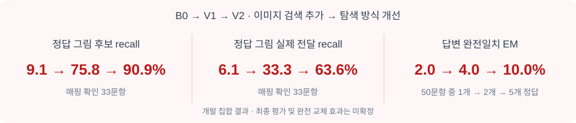
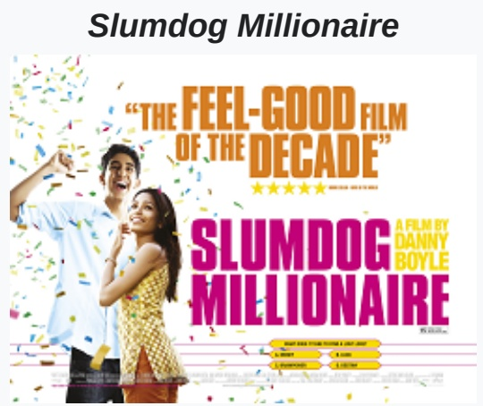
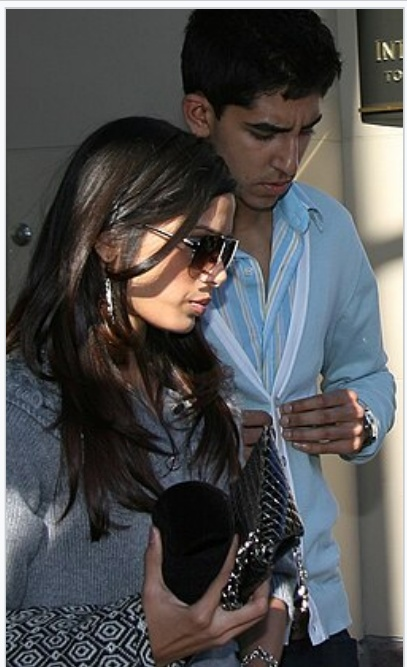
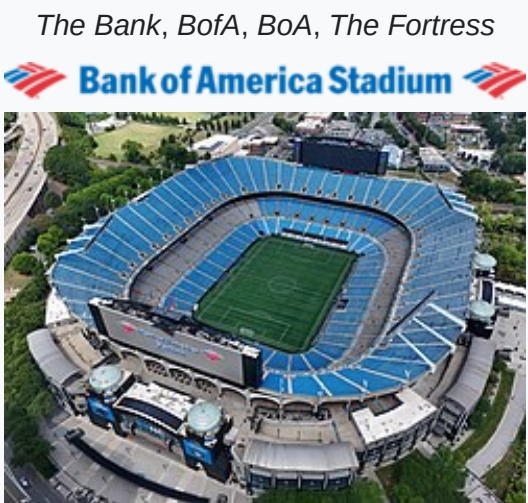
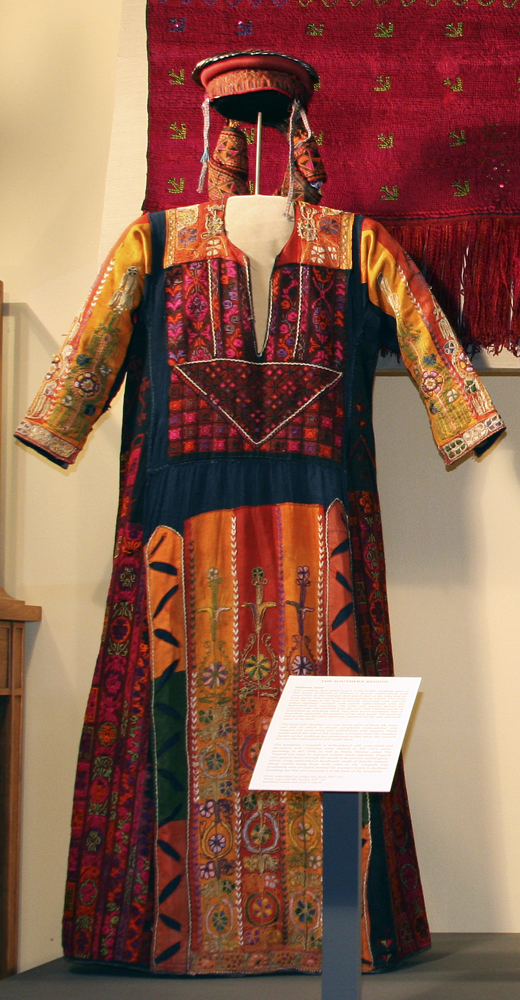
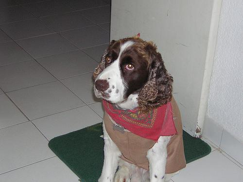
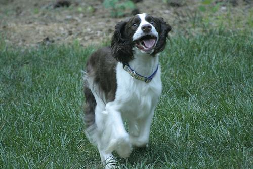
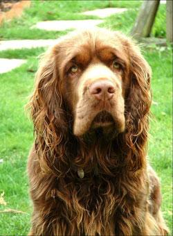

# Google 멀티모달 임베더는 A-RAG에 도움이 되는가?

**중간 결과 보고서 · 2026-10-13 · 개발 집합 기준**

## 1. 배경과 목적

Qwen 텍스트 임베더 대신 Google 멀티모달 임베더를 쓰면 **이미지 근거를 더 잘 찾고, 답변도 더 정확해지는가?** 이를 A-RAG 기반 검색·답변 시스템에서 확인한다.

현재는 **텍스트 임베더만 교체한 효과는 작고, 이미지 검색을 추가한 효과는 뚜렷하다.** 이미지 탐색 방식까지 바꾼 V2에서는 답변 정확도도 높아졌지만, 절대 정확도는 아직 낮다. Google의 텍스트·이미지 검색으로 Qwen을 완전히 대체한 조건은 아직 측정하지 않았다.

## 2. 방법

[A-RAG](https://github.com/Ayanami0730/arag)의 **검색 → 근거 읽기 → 필요하면 재검색 → 답변** 구조에 이미지 열람을 추가했다. 검색 결과에는 ID와 설명만 보여주고, 에이전트가 읽기를 요청한 뒤 실제 이미지를 Reader에 전달한다. B0도 연결된 이미지를 읽을 수 있다.

| 역할 | 사용 모델·설정 |
|---|---|
| PDF 파서 | MinerU2.5-Pro-2604-1.2B · standard tier · 원문 캡션 유지, 합성 캡션 미사용 |
| 기존 텍스트 임베더 | Qwen3-Embedding-4B · 2,560차원 |
| Google 멀티모달 임베더 | EmbeddingGemma 2 · 텍스트·이미지 각각 768차원 |
| 답변·LLM 판정 | Gemma 4 E4B-it · 판정은 별도 요청으로 수행 |
| 공통 예산 | temperature 0 · 최대 15루프 · 이미지 최대 8개 · reranker 없음 |

| 옵션 | 텍스트 검색 | 이미지 검색 | 비교하려는 효과 |
|---|---|---|---|
| **B0** | Qwen | 없음 | 기준 |
| **C1** | Google | 없음 | 텍스트 임베더 교체 |
| **V1** | Qwen 유지 | Google · 순위 융합(RRF) | 이미지 검색 추가 |
| **V2** | Qwen 유지 | V1 + 이미지 검색·열람 전용 도구 | 탐색 방식 개선 |

B0·C1·V1은 같은 도구·프롬프트를 사용한다. V2는 도구와 프롬프트를 함께 바꾼 조건이므로, 차이를 임베더 하나의 효과로 해석하지 않는다. 본 실험은 A-RAG의 멀티모달 확장이며 원 논문 점수 재현 실험은 아니다.

## 3. 벤치마크

| 벤치마크 | 무엇을 묻는가? | 이번 평가 범위 |
|---|---|---|
| [M3DocVQA](https://github.com/bloomberg/m3docrag) | 여러 Wikipedia PDF의 텍스트·표·이미지를 연결해 답변. 예: 영화 식별 후 포스터의 시각 속성 확인 | 이미지 관련 **개발 50문항**, 별도 최종 50문항. 개발 코퍼스 180문서, 최종 288문서 |
| [Mem-Gallery](https://github.com/YuanchenBei/Mem-Gallery) | 과거의 이미지 포함 대화에서 사진을 찾거나 내용을 추론 | **개발 10문항**, 별도 최종 50문항(VS 이미지 찾기 25 + VR 추론 25). 해당 시나리오의 대화만 검색 |

개발 집합과 최종 평가 집합은 분리했다. 아래는 모두 개발 결과이며, 최종 평가는 아직 시작하지 않았다.

## 4. 평가 결과

### M3DocVQA · 개발 50문항

| 옵션 | EM | F1 | LLM 판정 정확도 | 그림 후보 recall | 그림 전달 recall |
|---|---:|---:|---:|---:|---:|
| B0 | 2.0 | 4.58 | 2.0 | 9.1 | 6.1 |
| C1 | 2.0 | 4.40 | 2.0 | 9.1 | 6.1 |
| **V1** | **4.0** | **9.48** | **8.0** | **75.8** | **33.3** |
| **V2** | **10.0** | **13.66** | **14.0** | **90.9** | **63.6** |

단위 %. EM은 정규화 후 정답 완전일치, F1은 답변 겹침 점수다. 그림 지표는 정답 그림 매핑이 확인된 **33문항**의 문항별 recall 평균이다. 후보 발견과 Reader에 실제 전달한 것을 구분한다.

**해석:** 정답 그림을 찾는 V1에서 실제로 열어보는 V2로 개선이 이어졌다. EM 정답 수는 **B0 1개 → V1 2개 → V2 5개 / 50문항**이다. 텍스트 임베더 교체(C1)만으로는 개선이 없었다. V2는 평균 루프도 3.94회에서 6.74회로 늘어 추가 탐색 비용이 들었다. 개발 결과이므로 최종 평가 전 성능 우위를 확정하지 않는다.

### Mem-Gallery · 개발 10문항

| 옵션 | EM | F1 | 공식 LLM 판정 점수 |
|---|---:|---:|---:|
| B0 | 30.0 | 43.50 | 60.0 |
| V1 | 40.0 | 51.71 | 55.0 |
| V2 | 30.0 | 47.68 | 65.0 |
| 정답 근거 직접 제공 | 60.0 | 72.55 | 80.0 |

단위 %. 공식 판정 점수는 문항별 0·0.5·1의 평균이다. 정답 근거 직접 제공은 **답 문자열 없이 관련 대화·이미지만 제공한 Reader 진단**이며 검색 옵션과 구분한다.

**해석:** V1은 EM/F1이 높지만 판정 점수는 낮고, V2도 모든 지표에서 우세하지 않다. 근거 직접 제공 결과는 검색·전달을 개선할 여지를 보여준다. 표본이 작아 일반적인 우위는 아직 판단할 수 없다.

## 5. 정성 평가 · 실제 이미지와 실행 사례 4개

복구 후 V2 로그에서 **도움이 된 사례와 남은 한계**를 각각 골랐다. 사례는 동작을 설명하기 위한 선택이며, B0 대비 문항별 개선을 입증하는 비교는 아니다. 질문은 한국어로 옮겼고, 정답·출력·검색 기록은 연결된 로그에서 확인할 수 있다.

### ① M3DocVQA · 캡션 없는 포스터를 찾아 정답 도출

**질문:** Freida Pinto의 2008년 영화 포스터에서 두 사람 주위에 떠다니는 것은?  
**정답 / V2 답변:** confetti / Confetti — **정답**

| 원본 정답 이미지 | Reader에 전달한 포스터 | 함께 전달한 다른 사진 |
|---|---|---|
|  |  |  |

텍스트 검색으로 영화를 식별한 뒤, `image_search("Slumdog Millionaire two people")`가 **캡션 없는 정답 포스터를 첫 번째로 반환**했다. 이를 열어 색종이를 확인하고 맞혔다. **텍스트로 표현되지 않은 시각 정보를 찾는 데 Google 이미지 검색이 쓰인 사례**다. [실행 근거](assets/interim/m3_success_trace.json)

### ② M3DocVQA · 맞는 그림을 찾아도 세부 판독은 실패

**질문:** Bank of America Stadium 로고의 빨간 줄은 몇 개인가?  
**정답 / V2 답변 요지:** 8개 / 좌우 2개씩 총 4개 — **오답**

| 원본 정답 로고 | Reader에 실제 전달된 그림 |
|---|---|
|  |  |

정답 로고가 포함된 그림은 전달됐지만 줄 수를 잘못 셌다. 로고가 큰 경기장 사진의 일부로 작게 들어가 있다. **검색 이후 관심 영역 확대와 세부 판독 검증**이 필요함을 보여준다. 다만 확대하면 해결되는지는 추가 실험이 필요하다. [실행 근거](assets/interim/m3_limit_trace.json)

### ③ Mem-Gallery · 시각적 속성으로 정확한 사진 선택

**질문:** 대화 속 사진 중 자수가 놓인 축제 의상을 보여주는 것은?  
**정답:** `D7:IMG_001`  
**V2 답변:** `Architecture_Art_Culture_Exhibition_Technology:D7:IMG_001`

`image_search("embroidered festival costumes")` 후 정답 사진을 열었다. **이미지 선택은 맞았고 공식 LLM 판정도 1점**이다. 하지만 답변에 시나리오 접두어를 붙여 **EM은 0점**이었다. Google 이미지 검색이 유용하게 쓰였으며, 최종 출력 형식도 정확도에 영향을 준다. [실행 근거](assets/interim/mem_success_trace.json)

### ④ Mem-Gallery · 비슷한 대상보다 날짜 조건이 중요

**질문:** 4월 중순 대화에서 관찰한 Luna의 사진은?  
**정답 / V2 답변:** `D7:IMG_001` / `D2:IMG_002` — **오답**

| 정답: 4월 17일 · 열지 못함 | 선택한 사진: 3월 14일 | 함께 열어본 사진: 3월 14일 |
|---|---|---|
|  |  |  |

이 사례에서는 키워드 검색과 읽기만 사용했다. Luna라는 대상은 찾았지만 **4월 중순이라는 조건을 만족하지 않는 3월 사진으로 답했다.** 이미지 임베더만 바꾸기보다 날짜·세션 조건을 확인하고 재검색하도록 A-RAG의 종료 기준을 강화해야 한다. [실행 근거](assets/interim/mem_limit_trace.json)

## 6. 방향과 시사점

| 우선순위 | 바꿀 내용 | 이유 |
|---|---|---|
| 1 | **Google 텍스트 + Google 이미지** 조건을 B0·V1과 같은 도구·예산으로 비교 | Qwen 완전 교체의 효과를 직접 확인. 현재는 미측정 |
| 2 | A-RAG가 이미지 후보를 실제로 열고, 대상·날짜·질문 조건을 확인하도록 개선 | 후보 발견과 실제 전달 사이의 격차, 잘못된 세션 선택 해결 |
| 3 | 숫자·작은 로고는 관심 영역을 확대해 읽고, 이미지 ID는 정해진 형식으로 반환 | 세부 판독 오류와 출력 형식으로 인한 감점 감소 |

**현재 권고는 Google 멀티모달 임베더를 이미지 검색에 활용하되, A-RAG의 근거 선택·읽기·검증도 함께 개선하는 것이다.** “Qwen을 Google로 교체하면 답변 정확도가 오른다”는 결론은 완전 교체 조건과 최종 평가 후 판단한다.

## 7. 참조 링크

- 기반: [A-RAG](https://github.com/Ayanami0730/arag) · [M3DocVQA / M3DocRAG](https://github.com/bloomberg/m3docrag) · [Mem-Gallery](https://github.com/YuanchenBei/Mem-Gallery)
- 모델: [MinerU 파서](https://huggingface.co/opendatalab/MinerU2.5-Pro-2604-1.2B) · [Qwen 임베더](https://huggingface.co/Qwen/Qwen3-Embedding-4B) · [Google 임베더](https://huggingface.co/google/embeddinggemma-2) · [Reader](https://huggingface.co/google/gemma-4-E4B-it)
- M3 결과: [B0](development_B0_metrics.json) · [C1](development_C1_metrics.json) · [V1](development_V1_metrics.json) · [V2](development_V2_recovery_metrics.json) · [V2 문항별 점수](development_V2_recovery_question_metrics.jsonl)
- Mem-Gallery 결과: [B0](mem_gallery_development_B0.json) · [V1](mem_gallery_development_V1.json) · [V2](mem_gallery_development_V2_recovery.json) · [근거 직접 제공](mem_gallery_development_oracle_complete.json)
- 재현 정보: [모델·소스 revision](../../configs/upstream.json) · [이미지 출처·해시](assets/interim/provenance.json) · [실험 계획](../../docs/EXPERIMENT_PLAN.md)

*복구 전 B0·C1·V1 수치는 보존된 집계 보고서, V2 사례는 복구 후 실제 실행 로그에 근거한다. 유실된 이전 예측 로그를 복원한 것으로 간주하지 않으며, 병렬 실행 시간은 속도 비교에서 제외한다.*
