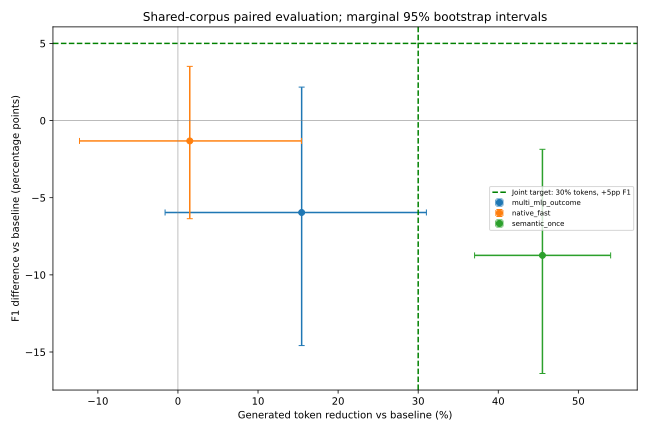

# Decision head 개선 결과

Split: test, n=80, policies=4. 동일질문paired비교. 단일학습seed.

| 정책 | F1 | 생성token | 입력token | 도구호출 | 오류 |
|---|---:|---:|---:|---:|---:|
| shared_grpo | 27.20 | 105.76 | 4862.0 | 2.462 | 1 |
| multi_mlp_outcome | 21.24 | 89.42 | 4605.3 | 2.550 | 0 |
| native_fast | 25.88 | 104.20 | 4826.7 | 2.487 | 0 |
| semantic_once | 18.46 | 57.62 | 2202.4 | 1.000 | 0 |

## 지정 baseline 대비

- multi_mlp_outcome: F1 delta -5.96pp, CI [-0.14583333333333334, 0.021666666666666664]; 생성ratio {'ratio': 0.8455265335066776, 'ci95': [0.6897550426913429, 1.0160619373336282]}; point목표 False, 방향CI False, 목표CI False.
- native_fast: F1 delta -1.32pp, CI [-0.06362259615384615, 0.03512820512820512]; 생성ratio {'ratio': 0.9852263325848009, 'ci95': [0.8457279859148166, 1.1229278091543557]}; point목표 False, 방향CI False, 목표CI False.
- semantic_once: F1 delta -8.74pp, CI [-0.16394471153846155, -0.018614583333333438]; 생성ratio {'ratio': 0.5448528542725446, 'ci95': [0.4596782258076289, 0.6295822877054025]}; point목표 False, 방향CI False, 목표CI False.

F1+5%p 및생성token−30% 동시목표. 확률은action확률이며정답확률아님. 단일seed/조건부CI/공식train원천의학습/검증가족분리holdout이며공통101962문단검색환경. validation은후보선택자료이므로최종확증아님. 최종test결과로후보재선택금지. 전체학습/수집비용별도보고. 통제latency비교없음.

## Native and fixed-workflow comparisons

|Reference|Policy|F1 delta (pp)|Marginal95% CI (pp)|Generated ratio|Marginal95% CI|
|---|---|---:|---|---:|---|
|native_fast|shared_grpo|+1.32|[-3.51, 6.36]|1.0150|[0.8905291968779392, 1.1824132802469236]|
|native_fast|multi_mlp_outcome|-4.64|[-12.64, 3.13]|0.8582|[0.7445686090790404, 0.9813844237913386]|
|native_fast|semantic_once|-7.42|[-15.17, -0.29]|0.5530|[0.503269950762696, 0.6059538022575149]|
|semantic_once|shared_grpo|+8.74|[1.86, 16.39]|1.8354|[1.5883547230345565, 2.175434780172748]|
|semantic_once|multi_mlp_outcome|+2.78|[-5.8, 11.61]|1.5518|[1.327403037535952, 1.8000543159437763]|
|semantic_once|native_fast|+7.42|[0.29, 15.17]|1.8082|[1.6502908254220665, 1.9870051820141645]|

CI는개별지표의marginal95%구간이며다중비교보정없음. 두CI조건통과를동시95%보장으로해석하지않는다.

