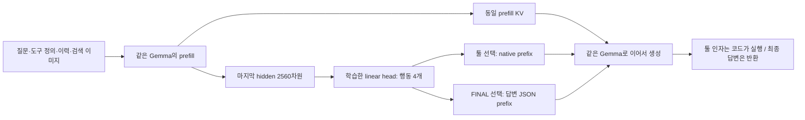
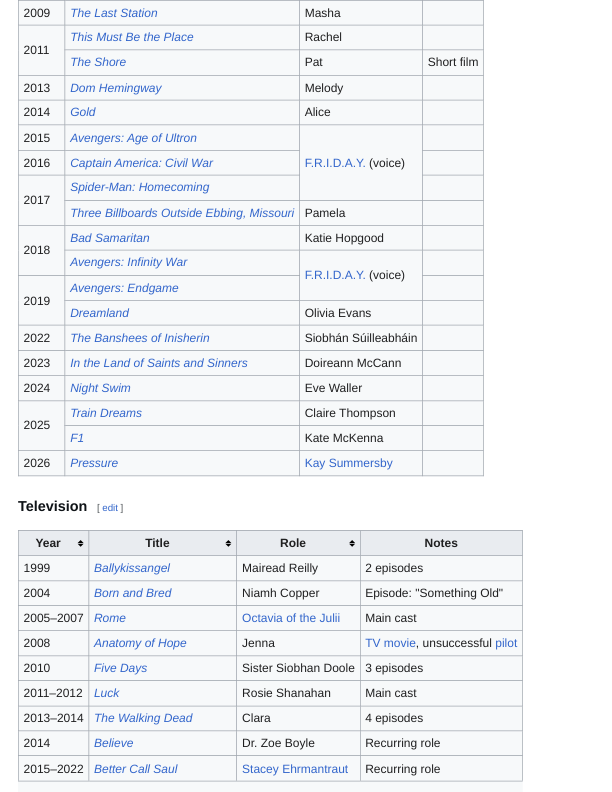

# 한 문항 상세 정성평가: Kerry Condon의 Olivia Evans 배역

**이 사례는 “기존 EM 오답 → 새 EM 정답”이지만, 기존 방식도 의미상 정답이었다. 새 방식의 관측 이점은 답변을 짧게 정리해 EM 형식에 맞춘 것과, 검색 snippet에 이미 있는 근거로 표 원문 읽기 한 턴을 생략한 것이다. 새로운 추론 능력이나 이미지 이해 향상의 증거로 해석하지 않는다.**

기존 평가 20문항에서 EM 0→1로 바뀐 유일한 문항을 기존 기록만으로 분석했다. 추가 풀이·재학습·GPU 추론은 하지 않았다. 원본 JSON·검색 결과·실제 입력 이미지·표를 함께 저장하여 별도 데이터 다운로드 없이 확인할 수 있다.

## 1. 질문·정답·이미지 조건

- **벤치마크:** M3DocVQA. 원 주석 유형은 `TableQ`, 정답 근거 modality는 `table`이다.
- **문항 ID:** `6068540027afe0ca92d9386391bf0889`.
- **원문 질문:** “Is Bad Samaritan the title of the film in which the role of Olivia Evans is played by Kerry Condon?”
- **한국어:** “Kerry Condon이 Olivia Evans 역을 맡은 영화의 제목이 Bad Samaritan인가?”
- **정답:** `No`.
- **질문 첨부 이미지:** 없음. 질문은 텍스트만 입력했다. **질문 이미지 캡션도 입력하지 않았다.**
- **검색 대상:** 문서 텍스트·표·이미지 및 연결 캡션. 두 조건 모두 동일한 EmbeddingGemma 2 검색 환경이다. 실제 이 문항은 `keyword_search`를 사용했고 `semantic_search`를 호출하지 않아 쿼리 임베딩 검색도 실행하지 않았다.
- **검색 후 Reader에 들어간 이미지:** 두 조건 모두 동일한 인물 사진 1장. 캡션 `Kerry Condon`, 주석 `Condon in 2022`가 있으며 실제 입력에 포함됐다. 이 사진은 질문 정답에 필요한 영화 배역 표와 구분한다.

[질문 원본](raw/question.json) · [정답·주석 원본](raw/gold.json) · [이미지·캡션 원본 메타데이터](raw/figures.json).

## 2. 추가된 모델은 무엇인가

Reader VLM은 두 조건 모두 **google/gemma-4-E4B-it**, revision `ee0ef6023621cff504d758262d4e04895a5af4a2`이다. EmbeddingGemma 2는 검색용 임베더이며 이번에 추가한 decision head와 다른 모델이다. Jev·OpenAI 등 외부 decision API는 사용하지 않았다.

추가된 것은 **같은 Gemma의 마지막 정규화 hidden vector 2,560차원에 붙인 4-class linear head**다. 새로운 별도 생성 LLM이 아니다. Gemma backbone과 vision 경로는 동결했다.

$$
\mathbf{h}\in\mathbb{R}^{2560},\qquad
\mathbf{z}=W\mathbf{h}+\mathbf{b},\qquad
W\in\mathbb{R}^{4\times2560},\quad \mathbf{b}\in\mathbb{R}^{4}
$$

$$
p(a\mid s)=\operatorname{softmax}(\mathbf{z})_a,
\qquad a\in\{\texttt{keyword\_search},\texttt{semantic\_search},\texttt{read\_chunk},\texttt{FINAL}\}
$$

추가 파라미터는 **10,244개**이고 float32 값만 계산하면 약 **40KiB**다. prefill 마지막 표현에서 행동을 한 번 분류하고, 같은 KV를 사용한다. 툴이 선택되면 해당 native tool prefix 뒤 검색어/청크 ID를 같은 Gemma가 생성한다. FINAL이면 기존 요구 형식의 `{"answers":` prefix 뒤 최종 JSON을 생성한다. 툴 실행은 Python 코드가 담당한다. 따라서 **도구 선택용 문자열 생성은 줄지만 인자·최종 답변 생성과 이미지 처리는 그대로 필요하다.**



헤드 학습은 성공 teacher의 행동을 모방한 CE다. 45개 문항·46개 성공 궤적의 197턴으로 head만 학습했다. 데이터 구성·실제 가중치 검사·과적합 한계는 [학습 검증 보고서](../../HEAD_TRAINING_AUDIT.md)에 별도로 기록했다.

## 3. 기존 방식과 새 방식의 전체 흐름

| 기존 Gemma A-RAG — B-HF | Gemma + decision head — D-head |
|---|---|
| **1턴:** Gemma가 `keyword_search`와 인자를 생성. 검색어는 `Olivia Evans`, `Kerry Condon`. | **1턴:** head가 `keyword_search` 선택. 같은 Gemma가 같은 두 검색어를 인자로 생성. |
| **검색 결과:** 5개 청크. 영화 배역 표의 snippet과 캡션 연결 인물 사진이 포함됨. | **검색 결과:** 청크 ID·순서·내용이 모두 기존 방식과 동일함. |
| **2턴 입력:** 검색 결과와 연결 인물 사진 1장이 들어감. | **2턴 입력:** 같은 검색 결과와 같은 인물 사진 1장이 들어감. 여기까지 입력 이력도 동일함. |
| **2턴 선택:** `read_chunk`로 영화 배역 표 원문 전체를 요청. | **2턴 선택:** head가 `FINAL`을 선택. 검색 snippet에 나타난 `Dreamland → Olivia Evans`를 이용해 바로 답변. |
| **3턴:** 표 전체를 입력받고 긴 설명과 답변 JSON을 생성. | **3턴 없음.** 표 원문을 추가로 읽지 않음. |
| **실제 answers:** `No, Bad Samaritan is not the title of the film in which Kerry Condon played the role of Olivia Evans.` | **실제 answers:** `No` |
| **판정:** EM=0, F1=0.12. **의미상으로는 정답.** | **판정:** EM=1, F1=1.00. 짧은 정답 형식과 일치. |
| Reader 호출 3회, 총 8.045초. | Reader 호출 2회, 총 3.209초. |

원본 실행 JSON은 [B-HF](runs/B-HF.json), [D-head](runs/D-head.json)에 바이트 그대로 보존했다. 같은 첫 검색 결과라는 점은 패키징 시 실제 JSON 동등성으로 검사했다. 기록된 전체 시간을 재측정하지 않았다.

2턴에서 head의 행동 확률은 다음과 같다. **행동 모방 softmax이며 정답 확률이 아니다.**

| 선택지 | 확률 |
|---|---:|
| keyword_search | 0.1166% |
| semantic_search | 0.0048% |
| read_chunk | 0.5386% |
| FINAL | **99.3400%** |

이 입력에서 기존 Gemma는 `read_chunk`, head는 `FINAL`을 선택했다. 99.34%가 모든 질문에서 안전하게 답할 수 있다는 뜻은 아니다.

## 4. 두 방식이 실제로 본 근거

**두 조건 공통의 표 검색 snippet 원문:**

```text
Kerry Condon ...  (voice)</td><td></td></tr><tr><td rowspan="2">2019</td><td>Avengers: Endgame</td><td></td></tr><tr><td>Dreamland</td><td>Olivia Evans</td><td></td></tr><tr><td>2022</td><td>The Banshees of Inisherin</td><td>Siobhán Súilleabháin</td><td></td></tr><tr><td>2023</td><td>In the Land of
```

[기존 snippet](evidence/B-HF_table_snippet.txt) · [새 방식 snippet](evidence/D-head_table_snippet.txt). 이 snippet에 이미 `Dreamland`와 `Olivia Evans`의 관계가 보인다. 따라서 이 문항에서는 표 전체를 읽지 않고도 `No`를 답할 근거가 있었다. 다만 다른 질문에서도 항상 snippet만으로 충분하다는 뜻은 아니다.

**표 원문에서 확인되는 관련 두 행:**

| 연도 | 영화 | 배역 |
|---|---|---|
| 2018 | Bad Samaritan | Katie Hopgood |
| 2019 | Dreamland | Olivia Evans |

[원문 HTML 표](evidence/full_table.html) · [모든 검색 후보와 읽은 청크](raw/chunks.json). 기존 방식은 이 표 원문을 `read_chunk`로 읽었고, 새 방식은 snippet만 봤다. **새 방식의 citation에 표 청크 ID가 있다는 사실은 표 원문을 읽었다는 뜻이 아니다.**

아래는 저장된 PDF의 실제 3페이지다. 사람이 표를 확인하기 위한 자료이며, **이 페이지 이미지를 Reader에 입력한 조건은 없다.** 기존 Reader가 받은 표는 HTML 텍스트다. 원 문서는 실험 당시 저장한 [Kerry Condon 문서](https://en.wikipedia.org/wiki/Kerry_Condon)이며 현재 웹 문서 상태와 구분한다.



**실제로 두 Reader에 입력한 공통 이미지는 아래 인물 사진 1장뿐이다.** 캡션 `Kerry Condon`, 주석 `Condon in 2022`도 입력됐다. 배역을 확인하는 데 직접적인 근거는 아니므로 이 사례를 이미지 이해 향상 사례로 사용하지 않는다.


## 5. 왜 모델을 추가했는데 시간이 줄었나

head 자체를 계산하는 시간보다 **줄어든 Reader 호출과 순차 토큰 생성 시간**이 훨씬 컸다. 이 사례의 전체 시간은 **8.045 → 3.209초, 60.1% 감소(2.51배)**다. 전체 20문항 평균 30.6% 감소와는 다른, 이 문항 한 건의 수치다.

| 기록된 비용 | 기존 B-HF | 새 D-head |
|---|---:|---:|
| Reader prefill 합계 | 0.6252초 | 0.2985초 |
| head 연산 합계 | 0 | 0.000276초 |
| 강제 prefix 처리 합계 | 0 | 0.04937초 |
| 순차 생성(decode) 합계 | 7.2449초 | 2.3037초 |
| 툴 실행 합계 | 0.1231초 | 0.5282초 |
| 기타 준비·파싱 등 잔여 시간 | 약 0.0514초 | 약 0.0289초 |
| **전체 wall time** | **8.0446초** | **3.2090초** |

위 분해는 각 호출 기록의 합계다. head와 prefix 비용도 포함했다. 두 조건의 툴 실행 시간은 실제로 새 방식이 더 길었으므로 “검색이 빨라졌다”는 설명은 맞지 않는다. 단일 실행의 CPU scheduling·검색 구현 등의 변동 원인은 이 로그만으로 확정하지 않는다.

구체적인 변화는 세 가지다.

1. **표 읽기 턴과 다음 prefill을 생략했다.** 기존 방식의 `read_chunk` 호출에는 청크 ID를 포함한 57토큰 생성이 필요했고, 이후 표 전체가 포함된 3,873 input tokens의 최종 Reader 호출이 한 번 더 있었다. 새 방식은 2턴에서 FINAL을 선택했다. 전체 prompt token 합계는 **7,592 → 3,719**다. 이 합계에는 반복 입력된 history도 포함하므로 고유 텍스트 양과 같지 않다.
2. **최종 출력이 짧아졌다.** 기존 방식은 JSON 앞 설명과 긴 answers 문장을 포함해 최종 호출에서 237토큰을 생성했다. 새 방식은 답변 prefix 3토큰 뒤 87토큰을 순차 생성했다. 기존 최종 decode 5.4824초에 비해 새 최종 decode는 1.9816초였다.
3. **행동 prefix를 토큰별로 생성하지 않았다.** 새 방식의 첫 툴 prefix 7토큰·최종 JSON prefix 3토큰은 한 블록으로 KV에 반영했다. 전체 completion accounting은 **316 → 112토큰**이고, 실제 autoregressive 생성 토큰은 **316 → 102토큰**이다. 새 방식의 나머지 10토큰은 강제 prefix이며 처리 비용을 별도로 포함했다.

따라서 속도 변화에는 **행동 선택·빠른 종료·답변 prefix·짧아진 문장**이 함께 섞여 있다. “head 계산만으로 60% 빨라졌다”거나 “동일한 풀이를 그대로 수행하면서 디코딩만 줄였다”고 단정할 수 없다. FINAL에서 JSON prefix만 강제하는 비교군은 실행하지 않았으므로 head와 출력 형식 효과도 분리되지 않았다.

## 6. “기존 오답 → 새 정답”의 정확한 의미

기존 answers의 첫 단어는 `No`이며 이유도 “Olivia Evans는 Dreamland의 배역”으로 맞다. 정답 주석은 한 단어 `No`다. 공식 정규화 EM은 구두점·대소문자 등을 처리하지만 긴 설명 문장을 `No` 한 단어와 같은 답으로 바꾸지는 않는다. 그래서 기존 EM은 0이고 새 EM은 1이다. 기존 출력은 JSON 앞 설명이 있어 `answer_format_valid=false`였지만, JSON 자체는 기계적으로 복구되었고 그 안의 긴 answers로 채점됐다. **JSON 파싱 실패로 답변이 사라져 틀린 사례도 아니다.**

두 방식의 reasoning 모두 올바른 영화·배역 관계를 언급한다. 이 사례로 확인할 수 있는 것은 **EM에 맞는 단답 형식과 더 짧은 실행 경로**다. 기존 방식이 근거를 못 찾았다거나 내용을 이해하지 못했다는 설명은 기록과 맞지 않는다. 기존 답변을 의미적으로 틀렸다고 세면 안 된다.

20문항 전체에서 이 한 문항이 EM 1/20→2/20 변화의 전부다. 따라서 이 사례 분석 후에는 **추론 정확도 향상보다 형식 준수와 실행 효율을 관측한 PoC**로 결론을 제한한다. EM 외의 정성적 정답 해석을 분리한 것이며 새로운 평가 LLM 점수를 추가하지 않았다.

## 7. 확인된 사실과 아직 모르는 것

| 확인된 사실 | 이 사례만으로 결론 낼 수 없는 것 |
|---|---|
| 동일 질문·동일 첫 검색 근거에서 행동 선택이 달라졌다. | head가 일반적으로 기존 Gemma보다 더 좋은 탐색 정책이라는 주장. |
| 새 방식은 snippet으로 답하고 표 읽기 한 턴을 생략했다. | 다른 질문에서도 일찍 답하는 것이 안전하다는 주장. |
| 기존 답도 의미상 맞았고 새 답은 EM 형식에 맞았다. | 의미적 추론 정확도가 개선됐다는 주장. |
| head·prefix 비용보다 생략된 호출·토큰 비용이 컸다. | 20문항 밖에서도 동일 비율로 빨라진다는 주장. |
| 같은 캡션 있는 인물 사진이 두 Reader에 입력됐다. | 멀티모달 임베더나 이미지 이해가 이 문항의 개선 원인이라는 주장. |

[실행 조건](raw/paired_manifest.json) · [문항별 metric 원본](raw/metrics.json) · [파일 해시·출처](manifest.json) · [전체 결과 보고](../../PROGRESS.md). 저장된 절대 경로는 원 실행의 출처이며, 이 문서의 상대 링크만으로 원문과 이미지 확인이 가능하다.
