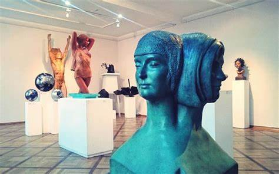
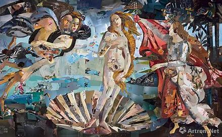
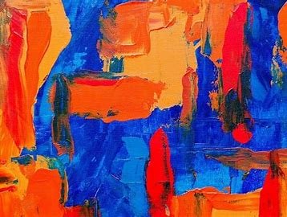
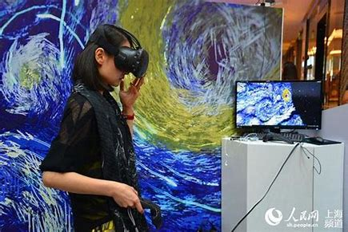
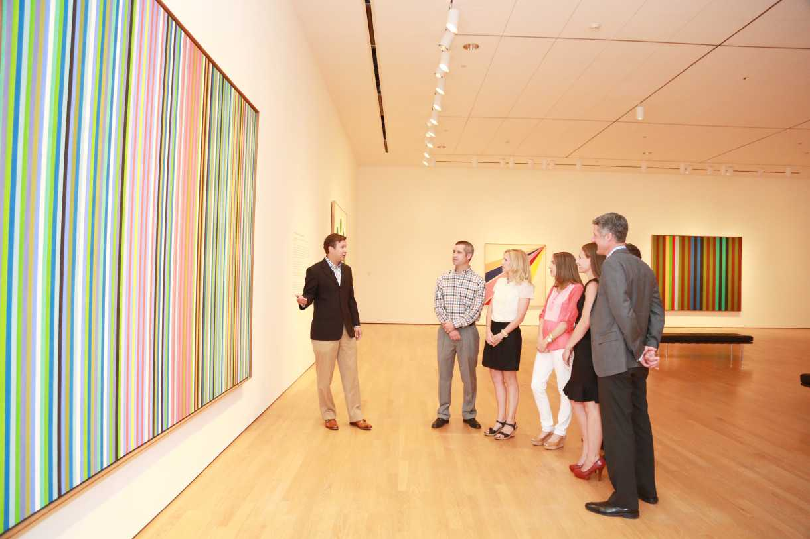

# Mem-Gallery · 대화에 나온 작품 이름

문항 `Architecture_Art_Culture_Exhibition_Technology:qa0068` · development. 모델·데이터 다운로드 없이 이 폴더의 JSON과 이미지를 열면 실행 현황을 확인할 수 있습니다.

**원문 질문:** What specific artwork mentioned in the conversation would be interesting to compare with the attached modern art image? Please return the artwork name.

**정답:** `"The Birth of Venus."`

**원래 질문 이미지:** 있음. **실제 Reader 입력:** 없음(세 조건 공통 text-only 정책).

- [원본 질문](raw/question.json) · [정답·주석](raw/gold.json) · [원 데이터 질문](raw/source_question.json)
- 전체 실행: [Qwen](predictions/B0.json) · [Google text-only](predictions/C1.json) · [Google multimodal](predictions/G1.json)
- [원문 청크](raw/chunks.json) · [원본 이미지 메타데이터](raw/figures.json) · [로컬 이미지 경로](figures_local.json) · [캡션 목록](caption_inventory.json)
- [파일 해시·출처](manifest.json). 기존 원본의 절대 경로는 출처 기록이며 `figures_local.json`의 `image_path`는 이 폴더 기준 상대 경로입니다.

## 실제 답변·입력 이미지

| 조건 | 답변 | 실제 입력 이미지 수 |
|---|---|---:|
| Qwen | `["Ancient paintings"]` | 0 |
| Google text-only | `["Impressionism (specifically, paintings of the same vase)"]` | 0 |
| Google multimodal | `["The Birth of Venus"]` | 5 |

### Qwen

전달 이미지 없음.

### Google text-only

전달 이미지 없음.

### Google multimodal

    
